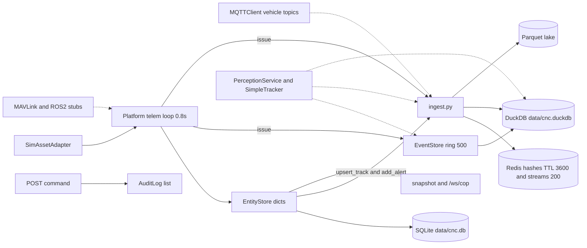
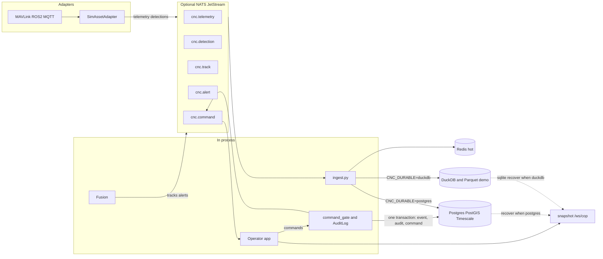

# Data Layer — POC to Enterprise

| | |
|---|---|
| **Document** | `docs/ARCHITECTURE_DATA.md` |
| **Author** | CNC platform |
| **Date** | 2026-10-12 |
| **Status** | Draft |
| **Scope** | Persistence, ingest, hot cache, audit. Not a new UI, not a new ontology. |
| **Related** | `docs/ONTOLOGY.md`, `docs/ARCHITECTURE.md`, `docs/EOI_TRACE.md`, `docs/PHASE_12_MONTHS.md`, `src/kernel/ontology.py`, `AGENTS.md` |

## Overview

The year-1 kernel already has the right objects and the wrong number of stores. One operator snapshot is assembled from process memory, a SQLite file of JSON blobs, a DuckDB file, a Parquet directory, and a Redis cache that the map does not read. A restart drops commands, the audit tape, the fusion tracker, and the event ring. Telemetry from the live FastAPI loop is not the telemetry in DuckDB or Parquet.

This design keeps the ontology names in `src/kernel/ontology.py` and the dict-shaped ports in `src/data/ports.py`. Demo and the current 92 pytest tests stay on in-memory fakes plus the current DuckDB/SQLite path. A default run passes 67 and skips 25 when Postgres, NATS, and Redis are unreachable. Production is one PostgreSQL database with PostGIS and TimescaleDB, selected by environment, with NATS as an optional bus between adapters and ingest. Adapters do not open a database. Fusion does not talk to hardware. The operator app still reads one snapshot and posts commands. Every command still produces an Event with operator id, time, and asset id, and that Event becomes a row in an append-only table instead of only a 500-deep list.

Zone is not added. Gotham link analysis and Foundry pipelines are not added.

## Background & Motivation

EOI clause 2.1 (Data & Services) is traced in `docs/EOI_TRACE.md` as "persist and query" with the gap "dual memory + DuckDB". `docs/ARCHITECTURE.md` already requires one snapshot JSON for the dashboard and an offline single-box demo. The code has grown a second snapshot (Redis), a second mission model, a second track model, and a telemetry table that the live page does not write.

What fails today, in the order an operator would notice:

1. Restart the FastAPI process and `/ws/cop` loses `recent_commands`. `EntityStore.commands` is a dict. Nothing writes it to `data/cnc.db`.
2. Restart loses `AuditLog.entries` (`src/security/audit.py`). `command_gate.stamp` records the HTTP command path only in that list.
3. Restart loses `EventStore._events` (cap 500). Rows that did reach `data/cnc.duckdb` `events` are not loaded back. `CNCDatabase.get_recent_events` has no caller. The Streamlit screen and the tests read the ring, not the table.
4. Restart loses `SimpleTracker.tracks` (`src/ai_fusion/tracking.py`). The global `tracker` is the fusion state. Its `positions` list is capped at 60 and never reloaded.
5. The live operator loop (`Platform._telem_loop` in `src/operator_app/app.py`, 0.8 s) updates SQLite asset blobs and operator tracks. It does not call `ingest_telemetry`. Redis hashes and `data/lake/telemetry/` are not the picture on `http://127.0.0.1:8000`.
6. DuckDB is opened at import by `db = CNCDatabase()` in `src/data_services/db.py`. A second process (Streamlit, smoke script, pytest) writes the same file. DuckDB has one writer. Failures are swallowed, so the map stays up and the mission record quietly does not.

Inspected on 2026-10-12 against the files on disk (DDL in code matches `PRAGMA table_info`; no extra tables and no secondary indexes):

| Store | File | Row counts on 2026-10-12 |
|---|---|---|
| DuckDB `commands` | `data/cnc.duckdb` | 4 |
| DuckDB `events` | `data/cnc.duckdb` | 15 (all `event_id` length 8) |
| DuckDB `telemetry` | `data/cnc.duckdb` | 44 (11 each of `uav-01`, `uav-02`, `ugv-01`, `ugv-02`) |
| DuckDB `assets`, `missions`, `detections`, `tracks`, `alerts` | `data/cnc.duckdb` | 0 |
| SQLite `assets`, `tracks` | `data/cnc.db` | 4 and 4 |
| SQLite `alerts` | `data/cnc.db` | 8 |
| SQLite `missions`, `observations` | `data/cnc.db` | 0 |
| Parquet | `data/lake/telemetry/date=2026-10-11/` | 4 files, 1 row each |

Empty tables are called out below next to the writer. A writer with no rows means the call has not landed in this file (or it raised and was swallowed). It does not mean the function is absent.

### 1. Persistence inventory

#### 1.1 DuckDB `data/cnc.duckdb` — `CNCDatabase` (`src/data_services/db.py`)

Path: `DB_PATH = Path("data/cnc.duckdb")`, resolved from the process working directory, not from the repo root. `CNCDatabase.__init__` connects and runs `_create_tables` on import of the module. Sequence `telemetry_seq` starts at 1. JSON columns are `VARCHAR` of `json.dumps`, not a JSON type. Primary keys only; no secondary indexes.

| Table | Primary key | Columns | Write | Read |
|---|---|---|---|---|
| `assets` | `asset_id VARCHAR` | `name`, `asset_type`, `capabilities VARCHAR`, `max_speed DOUBLE`, `created_at TIMESTAMP` | `upsert_asset` → `INSERT OR REPLACE`. **No caller.** 0 rows. | none |
| `telemetry` | `id BIGINT DEFAULT nextval('telemetry_seq')` | `asset_id`, `timestamp`, `lat`, `lon`, `alt`, `heading`, `speed`, `battery_percent`, `status`, `mode` | `insert_telemetry` → `INSERT`. **Only caller:** `src/operator_app/dashboard.py` local-simulation branch (MQTT down). 44 rows. | none in repo |
| `commands` | `command_id VARCHAR` | `asset_id`, `command_type`, `parameters VARCHAR`, `issued_by`, `issued_at` | `insert_command` → `INSERT OR IGNORE`. Caller: `DuckDBDurableStore.save_command`. 4 rows, full UUID command ids, `issued_by='operator-1'`. | none |
| `missions` | `mission_id VARCHAR` | `name`, `status`, `detection_lat`, `detection_lon`, `assigned_uavs VARCHAR`, `assigned_ugv`, `created_at`, `completed_at` | `upsert_mission` → `INSERT OR REPLACE`. Callers: `MissionManager.start_reconnaissance` and three updates inside `check_progress` (`src/command_control/mission_manager.py`). **`created_at` is set to `now()` on every replace.** 0 rows in this file. | `get_mission`. **No caller.** |
| `events` | `event_id VARCHAR` | `timestamp`, `event_type`, `asset_id`, `message`, `severity`, `data VARCHAR` | `insert_event` → `INSERT OR IGNORE`. Caller: `EventStore.add`. 15 rows. | `get_recent_events` (`ORDER BY timestamp DESC LIMIT ?`). **No caller.** |
| `detections` | `detection_id VARCHAR` | `timestamp`, `asset_id`, `lat`, `lon`, `label`, `confidence`, `mission_id` | `insert_detection` → `INSERT OR IGNORE`. Caller: `DuckDBDurableStore.save_detection`. 0 rows. | none |
| `tracks` | `track_id VARCHAR` | `updated_at`, `asset_id`, `lat`, `lon`, `label`, `status`, `confidence`, `payload VARCHAR` | `upsert_track` → `INSERT OR REPLACE`. Caller: `DuckDBDurableStore.save_track`. 0 rows. | none |
| `alerts` | `alert_id VARCHAR` | `timestamp`, `asset_id`, `level`, `message`, `payload VARCHAR` | `insert_alert` → `INSERT OR REPLACE` (not ignore). Caller: `DuckDBDurableStore.save_alert`. 0 rows. | none |

`DuckDBDurableStore` (`src/data_services/durable.py`) is the ingest adapter over this connection, except telemetry. `save_telemetry` does **not** call `insert_telemetry`. It calls `append_telemetry([record])` and writes a Parquet file.

`save_track` requires `track_id` or `id`. It maps `updated_at` / `last_update` / `last_seen` / `ingested_at`, `source_asset_ids[0]` or `asset_id` or `source_asset`, `label`, `status` or `state`, and stores the whole dict as `payload`. `save_detection` requires `detection_id` or `id`. `save_alert` requires `alert_id` or `id` and uses `message` or `title`. `save_command` requires `command_id` or `id`, maps `command_type` or `type`, and defaults `issued_by` to `actor` or `"operator"`.

#### 1.2 Parquet lake `data/lake/telemetry/` — `src/data/historical.py`

`LAKE_ROOT = Path("data/lake")` (cwd-relative). Layout: `telemetry/date=YYYY-MM-DD/part-HHMMSSffffff.parquet`.

`append_telemetry(records)` builds a Polars frame, adds `ts` if missing, and writes **one new file per call**. Callers:

- `DuckDBDurableStore.save_telemetry` (one record per call), reached from `ingest_telemetry`.
- `scripts/smoke_data.py` directly.

`query_recent(platform_id, limit=100)` opens an in-memory DuckDB and runs `read_parquet('.../telemetry/**/*.parquet', union_by_name=true)`. Callers: `scripts/smoke_data.py`, `scripts/smoke_ingest.py`. The operator app does not call it. `platform_id`, the file path, and `limit` are all f-string interpolated. The path is a constant today. `platform_id` and `limit` are not: both must become bound parameters (`platform_id` as `VARCHAR`, `limit` as an integer). That is an injection bug, not a parameter bind.

The four files on disk are one row each and do not share a schema. Three have `platform_id, lat, lon, alt, mode, battery, updated_at, ts`. One also has `role` and `pedigree`. `battery` is `Int64` in every current part. `alt` is `Float64` in the three parts without `role`/`pedigree`, and `Int64` in the part that has them. `union_by_name=true` is load-bearing. There is no retention, compaction, or close-on-shutdown flush. At the live loop rate, routing that loop through `append_telemetry` as written would create about 5 files/s (4 assets / 0.8 s) — on the order of 4×10^5 files/day. That writer must be batched before any new caller is attached to the DuckDB/Parquet path. A Postgres hypertable insert does not have this file-per-sample problem.

#### 1.3 Redis — `RedisLiveStore` (`src/data/redis_live.py`)

`CNC_REDIS_URL`, default `redis://localhost:6379/0`. Connect is lazy (`socket_connect_timeout=0.5`). Constants the tests lock in (`src/data/test_ingest.py`): `HOT_TTL_S = 3600`, `STREAM_MAXLEN = 200` with `approximate=True`.

| Key / channel | What `put` does |
|---|---|
| Hash `cnc:{kind}:{object_id}` | `HSET` field `body` = JSON, then `EXPIRE` 3600 s. `get` prefers `body` and still accepts a legacy flat hash. |
| Stream `cnc:stream:{kind}` | `XADD` field `body`, `MAXLEN ~ 200`. `read_recent` is `XREVRANGE`. |
| Pub/sub | `publish(channel_for(kind), raw)`. |

`channel_for`: kind `platform` → `cnc:telemetry`. Kinds `track`, `detection`, `alert`, `command` → `cnc:track`, `cnc:detection`, `cnc:alert`, `cnc:command`. Any other kind → `cnc:{kind}`.

`ingest_telemetry` writes kind **`platform`**, not `telemetry`. The other ingest functions use `track`, `detection`, `alert`, `command`. `src/data/realtime.py` (`set_platform_state`, `get_platform_state`, `list_platforms`) is a thin wrapper, used by the smoke scripts. `list_ids` uses `KEYS`. Nothing in `src/operator_app/app.py` reads Redis. `GET /snapshot` and `/ws/cop` do not.

At 40 assets × 1 Hz the stream keeps about 5 seconds, not an hour. The hash TTL is not the history window. Redis stays a latest-value cache. It is not the mission record and it will not become one.

#### 1.4 Operator SQLite `data/cnc.db` — `Database` / `EntityStore` (`src/operator_app/app.py`)

Path: `BASE.parent.parent / "data" / "cnc.db"` where `BASE` is `src/operator_app/` (repo `data/cnc.db`, not cwd-relative). Opened with `aiosqlite` in `Platform.start`, not at import. `row_factory = Row`. Each table is an id plus a Pydantic JSON blob. No secondary indexes.

| Table | Primary key | Other columns | Write | Read |
|---|---|---|---|---|
| `assets` | `id TEXT` | `data TEXT NOT NULL`, `updated_at TEXT NOT NULL` | `save_asset` `INSERT OR REPLACE`. Callers: `EntityStore.upsert_asset`, `update_from_telem`. | `load_assets` `SELECT data FROM assets`. Caller: `EntityStore.recover`. |
| `missions` | `id TEXT` | `data`, `updated_at` | `save_mission`. Caller: `upsert_mission`. | `load_missions`. Caller: `recover`. |
| `tracks` | `id TEXT` | `data`, `updated_at` | `save_track`. Copies the track and **slices `history` to the last 10** before `model_dump_json`. Caller: `upsert_track`. | `load_tracks`. Caller: `recover`. |
| `alerts` | `id TEXT` | `data`, `created_at` | `save_alert` `INSERT OR REPLACE`. Caller: `add_alert`. | `load_alerts` `ORDER BY created_at DESC LIMIT ?`. `recover` asks for 30. Default argument is 50. |
| `observations` | `id TEXT` | `data`, `created_at` | `save_observation` `INSERT` only (new UUID each call). Callers: the method itself and `POST /sensors/observe`. | **No `SELECT` anywhere.** 0 rows. Not loaded by `recover`. |

Blob shapes actually stored (not a second schema, the Pydantic models in the same file):

- Asset: `id, name, asset_type, status, lat, lon, alt, heading, speed, battery, capabilities, home_lat, home_lon, last_seen`. Live ids are the operator UUIDs (`Eagle-1` is `99b7a468-8321-4d7e-91a5-ef1f7f4c9c7b`, and the other three fleet names match the ids already used by the running page). Sim string ids (`uav-01`) are a different id space in `simulations/simple_assets.py`.
- Track: `id, label, track_type, state, lat, lon, alt, heading, speed, confidence, source_asset_ids, first_seen, last_update, attributes, history`. On disk, `history` length is 10. In memory `TrackManager` caps `history` at `MAX_HISTORY = 30`.
- Alert: `id, level, title, message, asset_id, timestamp, acknowledged, source`.

`EntityStore` also holds `commands: dict[str, Command]`. `Platform.issue` assigns `self.store.commands[cmd.id] = cmd` and never calls a SQLite save. `snapshot()` includes the latest 15 by `issued_at`. After `recover()`, that list is empty.

`POST /assets/{asset_id}/command` builds a `Command`, sets `issued_by` from `stamp()`, then `issue()`. `start_mission` / `abort_mission` call `issue()` with `issued_by="mission"` and do not call `stamp()`.

#### 1.5 Event ring — `EventStore` (`src/data_services/event_store.py`)

Not a table. Global `event_store = EventStore(max_events=500)`. `Event.event_id` is `str(uuid.uuid4())[:8]` (confirmed on the 15 stored rows). `add` appends to `_events`, trims to the last 500, then `db.insert_event` inside `try/except` that prints and swallows. `get_recent`, `get_alerts`, `get_by_asset` scan the list only. `get_alerts` and `clear` have no caller outside the class. `get_recent` is used by `src/operator_app/dashboard.py` (last 12). The two command tests use `get_by_asset`.

`EventType`: `command`, `status_change`, `alert`, `health`, `mission`, `detection`, `info`. There is no `operator_id` column. The command path stuffs it into `data` as `operator_id` (`_record_command_event`).

Importing `event_store` imports `db` and opens DuckDB. `test_issue_records_operator_event` and `test_record_command_writes_one_event_and_hot_command` both hit this global. The first does not call `configure()`, so its event row is a real DuckDB write. The second stubs ingest only; the event row still goes to DuckDB today.

#### 1.6 Audit tape — `AuditLog` (`src/security/audit.py`)

Not a table. `AuditEntry`: `at, session_id, issuer, role, asset_id, verb, accepted, reason`. No `command_id`. `authorise` appends to `self.entries` and raises `PermissionError` when `role is Role.OBSERVER`. `issued_by` returns `"{role.value}:{issuer}"`.

`src/operator_app/command_gate.py` holds the process-global `audit_log = AuditLog()` and `operator = Session(issuer="op-1", role=Role.OPERATOR)`. `stamp(asset_id, verb)` is called only from `POST /assets/{asset_id}/command`. `simulations/acceptance_run.py` builds a **different** `AuditLog()` and never touches the global or a database. Both tapes die with the process.

#### 1.7 Other in-memory structures (not tables)

| Structure | Where | Lost on restart | Notes |
|---|---|---|---|
| `SimpleTracker.tracks: dict[str, Track]` | global `tracker` in `src/ai_fusion/tracking.py` | yes | `positions` capped at 60. Status `tentative\|confirmed\|coasting\|lost`. Id `T-` + 4 hex chars. |
| `TrackManager._asset_to_track` | `src/operator_app/app.py` | yes | Rebuilt by matching `label == asset.name` and `track_type == friendly`. |
| `MissionManager.current` | `src/command_control/mission_manager.py` | yes | Separate `Mission` model (`mission_id`, `assigned_uavs`, `assigned_ugv`, `notes`). DuckDB is the only durable copy, and only if `upsert_mission` ran. |
| `MissionCoordinator.assets`, `.tasks` | `src/command_control/coordinator.py` | yes | `Task` dataclass (`task_id`, `description`, `target: Position`, `preferred_types`, `assigned_asset`, `status`, timestamps). No table. `mission_id` is one uuid8 on the coordinator, not a row. |
| `SimulatedAsset.trail` | `simulations/simple_assets.py` | yes | Last 80 `[lat, lon]` points. `MockAsset` in `app.py` is unused by `lifespan` (the live page registers `SimAssetAdapter`). |
| Streamlit `session_state.fleet`, `mqtt_telemetry`, `mqtt_mission` | `src/operator_app/dashboard.py` | yes | Second UI. Not the live page. Do not extend it. |
| `Platform.adapters` | `app.py` | yes | Runtime wiring only. |
| Perception detector | `perception_service` in `src/ai_fusion/perception.py` | n/a | Constructing the module loads `YOLODetector`. Not a store. Ingest must not import this module (cycle, and a weight-file side effect). |

`src/asset_integration/models.py` defines `Position`, `Telemetry`, `Command` (`command_id`, `type`, `issued_by`), `AssetInfo`, `AssetState`. Those are the adapter contracts. They are not tables. `src/operator_app/app.py` defines a second `Command` (`id`, `command_type`) and a second `Telemetry` (flat lat/lon, no nested `Position`). `ingest_command` already accepts both id keys. This design does not merge the classes.

MQTT (`src/communication/mqtt_client.py`) is a vehicle transport: `assets/{asset_id}/telemetry`, `assets/{asset_id}/command`, plus the Streamlit subscription `mission/status`. It is not a database and it is not the internal bus proposed below. `MAVLinkAdapter` and `ROS2Adapter` are stubs. They do not open a database. `SimAssetAdapter` does not either; `Platform` does.

### 2. Data flow today



Solid arrows are the FastAPI demo path. Dotted arrows are the Streamlit/MQTT path, stubs, or code that does not run on that path. Fusion is dotted on purpose. `Platform._telem_loop` never calls `PerceptionService`. The only `process_asset` call is `MissionManager.check_progress`, and `src/command_control/mission_manager.py` assigns `perception_service = None`, which shadows the object built in `perception.py`. On the Streamlit fallback, once a mission is `EXECUTING` and `uav-01.trail` is longer than 6, that call raises `AttributeError` before `ingest_detection` or `ingest_track`. Empty DuckDB `detections` (0) and `tracks` (0) are not only swallowed writes. Importing `src/ai_fusion/tracking.py` imports `perception.py` at module level, so importing `tracker` constructs `YOLODetector`. Ingest and the bus must not import `perception.py` or `tracking.py`.

| Step | What moves | Where it lands | Survives restart? |
|---|---|---|---|
| Adapter `get_telemetry` | `SimAssetAdapter` ticks `SimulatedAsset.update` and returns operator `Telemetry` | `EntityStore.update_from_telem` → SQLite `assets`; `TrackManager.update_from_asset` → SQLite `tracks` and `ingest_track` | SQLite yes. Fusion tracker no. DuckDB `tracks` only if `ingest_track` did not throw (0 rows in the current file). Redis only if Redis was up. |
| Low battery | New `Alert` every 0.8 s while `battery < 20` | SQLite `alerts` + `ingest_alert` | SQLite yes, and it will grow without an edge trigger. |
| `POST /sensors/observe` | `SensorObservation` | SQLite `observations` (never read) and maybe a track / alert | Row yes, unused. |
| Fusion `process_asset` (not the live page) | `DetectionResult` → `tracker.update`, if the service were not `None` | Would call `ingest_track`, `ingest_detection`, `event_store.add` | Not a FastAPI writer. The live track writer is `EntityStore.upsert_track` → `ingest_track` (actor `"operator"`). DuckDB `tracks` and `detections` are both 0 rows. |
| `POST /assets/{id}/command` | `stamp`, then one `OperatorAction`, then `Command` | `OperatorAction` per request; `_record_command_event` before `dispatch_command` | The command Event is committed before the adapter runs. A failed write raises `ProvenanceError` and the route returns HTTP 503. The adapter is not called. |
| Mission start/abort | `Command` with `issued_by="mission"` | Same as issue, **no** `stamp` | Same. |
| `ingest_telemetry` | Dict stamped with `platform_id, role, pedigree, ts, ingested_at, actor` | Redis kind `platform`; Parquet via `save_telemetry` | Redis 1 h / 200. Parquet yes. **Not called by the FastAPI loop.** Called by Streamlit MQTT callback, Streamlit fallback (which also `insert_telemetry` into the DuckDB table), and `scripts/smoke_ingest.py`. |
| Snapshot | `EntityStore.snapshot` every 1.0 s on `/ws/cop` | Browser | Memory + SQLite entities. Not Redis. Not DuckDB events. `recent_commands` from the dict only. |

`ingest.py` contract, which the tests pin: `configure(live, durable)` installs fakes; `None` restores the process defaults (`RedisLiveStore`, `DuckDBDurableStore`). `_write_live` and `_write_durable` log and swallow. A missing id still raises (`_require_id`), so a command is not dropped just because Redis is down (`test_live_failure_still_writes_durable`). The command Event is **not** written inside `ingest_command`. The docstring says the caller owns it. `_record_command_event` is that caller.

Two mission writers do not share rows. Operator missions are SQLite blobs (`id`, `assigned_assets`, waypoints, status `planned\|active\|completed\|aborted`). C2 missions are DuckDB columns (`mission_id`, `assigned_uavs`, `assigned_ugv`, status `idle\|planning\|executing\|detection\|investigating\|completed\|failed`). Two track writers can also target DuckDB `tracks`: fusion ids `T-XXXX` with `status`, operator ids UUID with `state` mapped into `status` by `save_track`. The current file simply has no track rows yet.

## Goals & Non-Goals

### Goals

- One production database for assets, missions, tasks, commands, tracks, alerts, telemetry, detections, events, and the audit tape. Ontology names stay. `Position` is a `geography` column, not a new object.
- DuckDB + SQLite + in-memory fakes remain the demo and the pytest path. Postgres is opt-in. NATS is opt-in.
- Adapters publish or return telemetry. They do not import `CNCDatabase`, `aiosqlite`, or the Postgres driver.
- Fusion publishes tracks, detections, and alerts. It does not open sockets to vehicles and does not open the database.
- The operator app keeps a single snapshot and posts commands. `/ws/cop` stays the map feed.
- Commands and events are insert-only. Audit is insert-only. Operator id, time, and asset id are columns, not only a JSON field.
- Hot Redis limits stay 3600 s and stream maxlen ~200. Key names that `test_redis_live_store_uses_phase1_keys` asserts stay, including kind `platform` and channel `cnc:telemetry`.
- Each migration step keeps the current suite green without requiring Postgres, NATS, or a running Redis for the default run. `pytest --collect-only` reports 92 tests. A default run passes 67 and skips 25 when those services are unreachable. The original files are still in that suite:
  - `src/data/test_ingest.py` (6)
  - `src/operator_app/adapters/test_sim_asset_adapter.py` (5)
  - `src/operator_app/test_command_event.py` (1)

### Non-goals

- A second Asset or Mission Pydantic model, or merging the two that already exist. The repository accepts dicts, as `DurableStore` does now.
- Zone, keep-in/out, or any polygon table. `ObjectName.ZONE` stays "not implemented" until a mission needs it.
- Gotham link-analysis UI, a graph database, Foundry pipelines, multi-tenant RLS, or a classified ontology studio.
- Weapons release, command signing beyond the existing role check, or a new operator UI. Streamlit is not extended. `dashboard.py` is only touched to stop a duplicate telemetry write.
- Replacing MQTT/MAVLink/ROS 2 as the vehicle link. Those stay on the far side of the adapter.
- Moving `/ws/cop` onto Redis. Redis is the wrong durability and the wrong retention.
- Making the 92 tests require Docker, Postgres, NATS, or Redis. Tests that need a broker stay skipped unless the service is reachable.

## Proposed Design



When `CNC_BUS=off` the bus nodes are skipped and the current function calls run in process. When `CNC_DURABLE=duckdb` the Postgres node is not opened.

### Config

No new file is committed under `.env`. No DSN with a password is committed. Readers live in one small module (proposed `src/data/settings.py`) so `ingest.get_durable` and `ingest.get_live` stay the only constructors tests can bypass via `configure`.

| Variable | Values | Default | Effect |
|---|---|---|---|
| `CNC_DURABLE` | `duckdb` \| `postgres` | `duckdb` | Durable store implementation. Demo and rollback. |
| `CNC_BUS` | `off` \| `nats` | `off` | In-process calls, or NATS between adapters and ingest. |
| `CNC_REDIS_URL` | Redis URL | `redis://localhost:6379/0` | Already implemented. Unchanged. |
| `CNC_POSTGRES_DSN` | libpq URL | unset | Required only when `CNC_DURABLE=postgres`. Password via env or `~/.pgpass`, not git. |
| `CNC_NATS_URL` | URL | `nats://127.0.0.1:4222` | Used only when `CNC_BUS=nats`. |
| `CNC_AUDIT_STRICT` | unused | unset | Not read. The command Event is written before dispatch. A failed write raises `ProvenanceError` and `POST /assets/{id}/command` returns HTTP 503. The adapter is not called. Each request records an `OperatorAction`. |

Startup rule: `sys.exit` runs only from `Platform.start` / the FastAPI lifespan, and only when that process was asked for `CNC_DURABLE=postgres` and the DSN is missing or the server refuses the pool. It does not silently fall back to DuckDB. Fallback hides a missing mission record. Rollback is a restart with `CNC_DURABLE=duckdb` and `CNC_BUS=off`.

`get_durable()` must not call `sys.exit`. `EventStore.add` calls it from tests that never call `Platform.start()`. A leaked `CNC_DURABLE=postgres` raises a normal exception (`RuntimeError` or the driver's connection error). `EventStore.add`'s existing `except Exception` logs it and keeps the in-memory event, which is what a swallowed DuckDB failure does today. `SystemExit` is not an `Exception` and must not be raised on that path. An unset `CNC_DURABLE` stays `duckdb` and must not construct a Postgres client. PR 1 includes a settings test for that.

Postgres and NATS clients are not constructed at import. `db = CNCDatabase()` already runs at import; do not add a second one. The asyncpg pool is opened in `Platform.start` and closed in `Platform.stop`. Tests that import `event_store` keep working with only a local DuckDB file.

### 3. PostgreSQL + PostGIS + TimescaleDB

One database, one schema `cnc`, WGS84. Map positions are `geography(Point, 4326)` so `ST_DWithin` is in metres (the code already uses haversine metres in `SimpleTracker._haversine_m` and `MissionCoordinator.distance_meters`). Altitude, heading, and speed stay numeric columns. A 2D point is not asked to carry altitude.

Demo coordinates are decimal degrees around 17.38 N, 78.49 E. Nothing in the repo is a local grid.

Application role `cnc_app` is `LOGIN NOSUPERUSER NOCREATEDB NOINHERIT`. Owner role `cnc_owner` is `LOGIN` and owns the schema, the tables, and the export job. The app DSN is `postgresql://cnc_app@127.0.0.1:5432/cnc`. A `NOLOGIN` role cannot be that user (`role "cnc_app" is not permitted to log in`), including under trust authentication. No password is in the SQL file or this document. The laptop image uses `POSTGRES_HOST_AUTH_METHOD=trust` over the published TCP port, so `cnc_app` connects as itself. `GRANT cnc_app TO` an OS user is not a substitute: that is peer auth, and the boot command is not peer auth. A lab host sets the password from the environment after this script (`ALTER ROLE` is not committed). The image superuser runs the extensions and `CREATE ROLE`. `SET ROLE cnc_owner` is in effect before every `CREATE TABLE`, `create_hypertable`, and `GRANT`, so PR 10 can `drop_chunks` and `DELETE` as the owner.

```sql
-- Database cnc already exists. Run as the image superuser. No password in this file.
CREATE EXTENSION IF NOT EXISTS postgis;
CREATE EXTENSION IF NOT EXISTS timescaledb;

CREATE ROLE cnc_owner LOGIN;
CREATE ROLE cnc_app LOGIN NOSUPERUSER NOCREATEDB NOINHERIT;

CREATE SCHEMA IF NOT EXISTS cnc AUTHORIZATION cnc_owner;
ALTER SCHEMA cnc OWNER TO cnc_owner;
GRANT USAGE ON SCHEMA cnc TO cnc_app;

SET ROLE cnc_owner;

CREATE TABLE cnc.assets (
    asset_id          text PRIMARY KEY,
    name              text NOT NULL,
    asset_type        text NOT NULL,
    status            text NOT NULL DEFAULT 'offline',
    capabilities      jsonb NOT NULL DEFAULT '[]',
    max_speed_mps     double precision,
    position          geography(Point, 4326),
    alt_m             double precision,
    heading_deg       double precision,
    speed_mps         double precision,
    battery_percent   double precision,
    home              geography(Point, 4326),
    last_seen         timestamptz,
    created_at        timestamptz NOT NULL DEFAULT now(),
    updated_at        timestamptz NOT NULL DEFAULT now()
);
CREATE INDEX assets_position_gix ON cnc.assets USING GIST (position);
CREATE INDEX assets_type_idx ON cnc.assets (asset_type);
CREATE INDEX assets_name_idx ON cnc.assets (name);
```

The SQL blocks below are the same script and the same session. `SET ROLE cnc_owner` stays in effect through `CREATE TABLE`, `create_hypertable`, compression policies, and the grant block. Do not run those statements as the image superuser, or `cnc_owner` will not own the tables PR 10 drops.

`asset_id` is the id the writer already has. Three id forms are legal and are not rewritten: operator UUIDs (Eagle-1 `99b7a468-8321-4d7e-91a5-ef1f7f4c9c7b`, Eagle-2 `2b52f017-a809-44e4-ac15-8f5b7aba0b3a`, Wolf-1 `173804a1-4d51-4d98-b9fb-6e957fe6d657`, Wolf-2 `e89bd6ac-9c42-4f60-9580-7f4cd09800f9`), sim ids (`uav-01`, `uav-02`, `ugv-01`, `ugv-02`), and coordinator ids (`UAV-01`, `UAV-02`, `UGV-01`, `UGV-02` in `acceptance_run.py`). Name is indexed, not unique: the live page reuses an asset by name at `Platform.register`.

Asset upserts use `ON CONFLICT (asset_id) DO UPDATE` and the `SET` list excludes `created_at`. DuckDB `upsert_asset` writes `datetime.now` on every `INSERT OR REPLACE`. Do not copy that. The same rule applies to `cnc.missions`.

```sql
CREATE TABLE cnc.missions (
    mission_id          text PRIMARY KEY,
    name                text NOT NULL,
    status              text NOT NULL,
    description         text NOT NULL DEFAULT '',
    notes               jsonb NOT NULL DEFAULT '[]',
    detection           geography(Point, 4326),
    assigned_asset_ids  text[] NOT NULL DEFAULT '{}',
    waypoints           jsonb NOT NULL DEFAULT '[]',
    area                jsonb,
    objectives          jsonb NOT NULL DEFAULT '[]',
    created_at          timestamptz NOT NULL DEFAULT now(),
    started_at          timestamptz,
    completed_at        timestamptz,
    updated_at          timestamptz NOT NULL DEFAULT now()
);
CREATE INDEX missions_status_idx ON cnc.missions (status, updated_at DESC);

CREATE TABLE cnc.tasks (
    task_id            text PRIMARY KEY,
    mission_id         text REFERENCES cnc.missions (mission_id),
    description        text NOT NULL DEFAULT '',
    status             text NOT NULL,
    target             geography(Point, 4326),
    alt_m              double precision,
    preferred_types    text[] NOT NULL DEFAULT '{}',
    assigned_asset_id  text,   -- no FK: coordinator ids are not asset rows
    created_at         timestamptz NOT NULL DEFAULT now(),
    started_at         timestamptz,
    completed_at       timestamptz,
    updated_at         timestamptz NOT NULL DEFAULT now()
);
CREATE INDEX tasks_mission_idx ON cnc.tasks (mission_id, status);
CREATE INDEX tasks_target_gix ON cnc.tasks USING GIST (target);
```

`status` is text on purpose. Operator missions and `MissionManager` missions use different vocabularies. A Postgres enum would reject one of them. Task is not a new ontology type. It is the row form of `command_control.coordinator.Task`. There is no foreign key from `assigned_asset_id` to `cnc.assets`. `acceptance_run.py` registers `UAV-01` and never inserts an asset row; a stub asset would show up on the map as a vehicle. `mission_id` stays nullable and keeps its foreign key. `save_task` looks up the mission first: if that id is not a `cnc.missions` row, it stores `mission_id` as null and logs a warning that names the skipped id. That warning is not the generic ingest swallow. The coordinator's own `mission_id` (`uuid4()` truncated to 8 hex characters) is not a missions row today, so the first writes will hit this path until a mission row exists. Upsert of a mission must not overwrite `created_at` (the DuckDB bug). Do not rewrite any of the three id forms.

```sql
CREATE TABLE cnc.commands (
    command_id    text PRIMARY KEY,
    asset_id      text NOT NULL,
    command_type  text NOT NULL,
    parameters    jsonb NOT NULL DEFAULT '{}',
    issued_by     text NOT NULL,
    issued_at     timestamptz NOT NULL,
    status        text NOT NULL,
    ingested_at   timestamptz NOT NULL DEFAULT now()
);
CREATE INDEX commands_asset_idx ON cnc.commands (asset_id, issued_at DESC);
CREATE INDEX commands_issuer_idx ON cnc.commands (issued_by, issued_at DESC);

REVOKE UPDATE, DELETE ON cnc.commands FROM cnc_app;
GRANT INSERT, SELECT ON cnc.commands TO cnc_app;
```

When the asyncpg pool is open, `issue` inserts this row with `status = 'accepted'` **before** `send_command`, inside `record_command`, together with the one Event and the audit row. `accepted` means the order is on the tape, not that the adapter has moved. The row is not updated when the adapter returns. The no-pool path, which is both command tests, does not call `record_command`. It delivers once and then calls `_record_command_event` once. The HTTP body still carries the in-memory `Command.status` of `sent` or `failed`. The tests assert that on the returned object, and they assert exactly one Event. `ON CONFLICT (command_id) DO NOTHING` matches today's `INSERT OR IGNORE` on `command_id` alone. Migrated DuckDB rows have no `status` column; the copy script inserts `sent` for those historical rows (see Data Model Changes). A second Event for adapter success would break `test_issue_records_operator_event`, so adapter success stays on the response object only.

```sql
CREATE TABLE cnc.events (
    event_id     text PRIMARY KEY,
    ts           timestamptz NOT NULL,
    event_type   text NOT NULL,
    asset_id     text,
    operator_id  text,
    message      text NOT NULL,
    severity     text NOT NULL DEFAULT 'info',
    data         jsonb NOT NULL DEFAULT '{}'
);
-- Not a hypertable. A unique index on a hypertable must include the partition column.
-- PRIMARY KEY (event_id, ts) would allow the same event_id at a new ts, which breaks
-- INSERT-once idempotency. Volume matches commands: a normal table is enough.
CREATE INDEX events_asset_idx ON cnc.events (asset_id, ts DESC);
CREATE INDEX events_type_idx ON cnc.events (event_type, ts DESC);
CREATE INDEX events_operator_idx ON cnc.events (operator_id, ts DESC);

CREATE TABLE cnc.audit_log (
    audit_id     bigint GENERATED ALWAYS AS IDENTITY PRIMARY KEY,
    at           timestamptz NOT NULL,
    session_id   text NOT NULL,
    issuer       text NOT NULL,
    role         text NOT NULL,
    asset_id     text NOT NULL,
    verb         text NOT NULL,
    command_id   text,
    accepted     boolean NOT NULL,
    reason       text NOT NULL DEFAULT ''
);
CREATE INDEX audit_issuer_idx ON cnc.audit_log (issuer, at DESC);
CREATE INDEX audit_asset_idx ON cnc.audit_log (asset_id, at DESC);

REVOKE UPDATE, DELETE ON cnc.events, cnc.audit_log FROM cnc_app;
GRANT INSERT, SELECT ON cnc.events, cnc.audit_log TO cnc_app;
GRANT USAGE, SELECT ON SEQUENCE cnc.audit_log_audit_id_seq TO cnc_app;
```

`operator_id` is a real column, copied from `data["operator_id"]` or from `issued_by`, so the mission record can be queried without parsing JSON. `events_operator_idx` is the index for that query. `command_id` on the audit row is the link `AuditEntry` does not have today. `authorise` still only appends to the memory list and still raises on `OBSERVER`. It does not open a database. When the pool is open, async `stamp` awaits `asave_audit` of that rejected row (`accepted=false`) and then re-raises, before `issue`, so there is no command and no event. When the pool is closed, the rejection stays on the memory list. An accepted command is not written by `stamp`. On the pool-open path its audit row is the one inside `record_command`, once.

Insert target for events: `INSERT INTO cnc.events (...) VALUES (...) ON CONFLICT (event_id) DO NOTHING`. Same conflict target as commands: the primary key alone.

New ids, leaving historical values untouched (do not rewrite them in the migration):

| Generator today | Bits | Failure if it collides | New value |
|---|---|---|---|
| `Event.event_id` = `uuid4()` hex[:8] | 32 | `ON CONFLICT DO NOTHING` drops the new event | full `uuid4()` string |
| `DetectionResult.detection_id` = `uuid4()` hex[:8] | 32 | same drop on `detection_id` | full `uuid4()` string |
| `MissionManager` `mission_id` = `uuid4()` hex[:8] | 32 | upsert merges two missions | full `uuid4()` string |
| Fusion `Track.track_id` = `T-` + 4 hex chars | 16 | upsert stitches two tracks into one row | `T-` plus a full `uuid4()` string |
| Operator command id, operator mission id | 128 | already full UUIDs | unchanged |

The tests compare event ids for equality, not length. Eight hex characters is not enough for a two-year detection log, and 16 bits is not enough for fusion tracks.

`cnc.events` and `cnc.audit_log` stay online 730 days. They are not hypertables, so retention is not `drop_chunks`. Commands use the same 730-day window and are not a hypertable either. `cnc_app` cannot `DELETE` any of them. The export job in PR 10 does the delete, only after a successful Parquet copy.

```sql
CREATE TABLE cnc.telemetry (
    ts               timestamptz NOT NULL,
    asset_id         text NOT NULL,
    position         geography(Point, 4326),
    alt_m            double precision,
    heading_deg      double precision,
    speed_mps        double precision,
    battery_percent  double precision,
    status           text,
    mode             text,
    role             text,
    pedigree         text,
    payload          jsonb NOT NULL DEFAULT '{}',
    PRIMARY KEY (asset_id, ts)
);
SELECT create_hypertable('cnc.telemetry', 'ts', chunk_time_interval => INTERVAL '1 day');
CREATE INDEX telemetry_pos_gix ON cnc.telemetry USING GIST (position);

ALTER TABLE cnc.telemetry SET (
    timescaledb.compress,
    timescaledb.compress_segmentby = 'asset_id',
    timescaledb.compress_orderby = 'ts DESC'
);
SELECT add_compression_policy('cnc.telemetry', INTERVAL '7 days');
-- No add_retention_policy. Timescale's policy drops chunks by itself and will not wait for an export.
```

Compression after 7 days is safe to install: it does not delete rows. Retention is only the export job in PR 10. That job copies a chunk to `data/lake/telemetry/date=YYYY-MM-DD/asset_id=<id>/part.parquet` (batched, not one file per sample), writes a success marker, and only then calls `drop_chunks` for that chunk. If the copy fails, the chunk stays and `cnc_retention_failures_total` increments.

`ingest_telemetry`'s `platform_id` argument is stored as `asset_id`. Redis kind stays `platform` so the existing key test does not change. `payload` holds `sensors`, `extras`, and any field that is not a column. Duplicate `(asset_id, ts)` is `ON CONFLICT DO NOTHING`.

Map "where are they now" uses `cnc.assets.position`, not a scan of telemetry:

```sql
SELECT asset_id, name, ST_Y(position::geometry) AS lat, ST_X(position::geometry) AS lon
FROM cnc.assets
WHERE ST_DWithin(
    position,
    ST_SetSRID(ST_MakePoint(78.4867, 17.3850), 4326)::geography,
    5000
);
```

```sql
CREATE TABLE cnc.tracks (
    track_id          text PRIMARY KEY,
    track_origin      text NOT NULL,          -- 'operator' or 'fusion'
    asset_id          text,
    source_asset_ids  text[] NOT NULL DEFAULT '{}',
    mission_id        text,
    label             text NOT NULL DEFAULT 'unknown',
    track_type        text,
    status            text NOT NULL DEFAULT '',
    position          geography(Point, 4326),
    alt_m             double precision,
    heading_deg       double precision,
    speed_mps         double precision,
    confidence        double precision,
    history           jsonb NOT NULL DEFAULT '[]',
    attributes        jsonb NOT NULL DEFAULT '{}',
    first_seen        timestamptz,
    updated_at        timestamptz NOT NULL,
    payload           jsonb NOT NULL DEFAULT '{}'
);
CREATE INDEX tracks_pos_gix ON cnc.tracks USING GIST (position);
CREATE INDEX tracks_origin_idx ON cnc.tracks (track_origin, status, updated_at DESC);

CREATE TABLE cnc.track_positions (
    track_id    text NOT NULL,
    ts          timestamptz NOT NULL,
    position    geography(Point, 4326) NOT NULL,
    alt_m       double precision,
    speed_mps   double precision,
    heading_deg double precision,
    confidence  double precision,
    PRIMARY KEY (track_id, ts)
);
SELECT create_hypertable('cnc.track_positions', 'ts', chunk_time_interval => INTERVAL '1 day');
ALTER TABLE cnc.track_positions SET (
    timescaledb.compress,
    timescaledb.compress_segmentby = 'track_id',
    timescaledb.compress_orderby = 'ts DESC'
);
SELECT add_compression_policy('cnc.track_positions', INTERVAL '7 days');
-- No add_retention_policy here either. PR 10 drops chunks only after export.
```

`track_origin` is set by `ingest_track` from the `actor` argument it already takes: `actor="fusion"` → `fusion`, `actor="operator"` → `operator`. It is not inferred from the id shape. `EntityStore.upsert_track` already calls `ingest_track(..., actor="operator")`. `PerceptionService` already calls `ingest_track(..., actor="fusion")`. Operator tracks (`TrackState`: `active|stale|lost`) upsert `tracks` and do **not** append `track_positions`. Fusion tracks (`TrackStatus`: `tentative|confirmed|coasting|lost`) upsert `tracks` and append one `track_positions` row per update. Upsert carries `WHERE excluded.updated_at >= cnc.tracks.updated_at` so a late packet cannot roll the current fix backwards.

The durable `history` jsonb is capped at 10 points. That matches `Database.save_track`, which slices to the last 10 before the SQLite write. The in-memory sparkline stays at `MAX_HISTORY = 30`. `/ws/cop` serialises the memory track, so a live snapshot can still show 30 points. A restart shows the 10 that were stored. Do not cap the memory list at 10 or the live page changes.

Current-track retention: rows with status `lost` and `updated_at` older than 30 days may be deleted by `cnc_owner` inside the same export job, after the history row is in Parquet. `track_positions` age out on the 180-day export-then-drop. Active rows stay.

```sql
CREATE TABLE cnc.detections (
    detection_id  text PRIMARY KEY,
    ts            timestamptz NOT NULL,
    asset_id      text NOT NULL,
    position      geography(Point, 4326),
    label         text NOT NULL DEFAULT 'unknown',
    confidence    double precision,
    mission_id    text,
    bbox          jsonb,
    image_path    text,
    raw           jsonb NOT NULL DEFAULT '{}'
);
CREATE INDEX detections_asset_idx ON cnc.detections (asset_id, ts DESC);
CREATE INDEX detections_pos_gix ON cnc.detections USING GIST (position);

CREATE TABLE cnc.alerts (
    alert_id          text PRIMARY KEY,
    ts                timestamptz NOT NULL,
    asset_id          text,
    level             text NOT NULL,
    title             text,
    message           text NOT NULL DEFAULT '',
    acknowledged      boolean NOT NULL DEFAULT false,
    acknowledged_at   timestamptz,
    source            text,
    payload           jsonb NOT NULL DEFAULT '{}'
);
CREATE INDEX alerts_open_idx ON cnc.alerts (acknowledged, ts DESC);
GRANT UPDATE (acknowledged, acknowledged_at) ON cnc.alerts TO cnc_app;

CREATE TABLE cnc.alert_history (
    alert_id   text NOT NULL,
    ts         timestamptz NOT NULL,
    action     text NOT NULL,       -- 'raised' or 'acknowledged'
    level      text NOT NULL,
    asset_id   text,
    message    text NOT NULL,
    actor      text,
    payload    jsonb NOT NULL DEFAULT '{}',
    PRIMARY KEY (alert_id, ts, action)
);
SELECT create_hypertable('cnc.alert_history', 'ts', chunk_time_interval => INTERVAL '30 days');

-- Still cnc_owner. This is the grant set the SQL file ends with.
-- Grants next to commands, events, and alerts are the same statements, not a second policy.
-- A GRANT on a hypertable parent applies to chunks Timescale creates later.
GRANT INSERT, SELECT, UPDATE ON cnc.assets, cnc.missions, cnc.tasks, cnc.tracks TO cnc_app;
GRANT INSERT, SELECT ON
    cnc.telemetry, cnc.track_positions, cnc.detections, cnc.alerts, cnc.alert_history
    TO cnc_app;
GRANT UPDATE (acknowledged, acknowledged_at) ON cnc.alerts TO cnc_app;
GRANT INSERT, SELECT ON cnc.commands, cnc.events, cnc.audit_log TO cnc_app;
REVOKE UPDATE, DELETE ON
    cnc.commands, cnc.events, cnc.audit_log,
    cnc.telemetry, cnc.track_positions, cnc.detections, cnc.alert_history
    FROM cnc_app;
GRANT USAGE, SELECT ON SEQUENCE cnc.audit_log_audit_id_seq TO cnc_app;
```

Detections are insert-only (`ON CONFLICT (detection_id) DO NOTHING`), matching `INSERT OR IGNORE`. They stay a normal table. Promote to a hypertable if a rolling week exceeds 50 million rows. Year-1 sim detections are occasional YOLO frames, not a video stream.

Alerts: `cnc.alerts` is the current COP row. There is no acknowledge route in the repo today (`Alert.acknowledged` exists, `list_alerts` hides acknowledged rows, and nothing sets the flag). PR 7 adds `POST /alerts/{alert_id}/ack`. When the pool is open the handler awaits the update of `acknowledged` and `acknowledged_at` (the only `UPDATE` granted to `cnc_app`), awaits the `alert_history` insert with action `acknowledged`, and awaits one `asave_event` after `event_store.add(..., persist=False)`. It does not also call sync `save_event`. Raising inserts history with action `raised` and does not update a previous alert row in place. `alert_history` is append-only for `cnc_app` (no UPDATE/DELETE). It is a hypertable with **no** `add_retention_policy`; PR 10 exports then drops chunks at 730 days. Acked current rows older than 30 days may be deleted by `cnc_owner` in that same job once a `raised` history row exists. Open alerts stay.

There is no `observations` table. `POST /sensors/observe` today calls `platform.db.save_observation` and then `TrackManager.ingest_observation` (track update, and sometimes an alert). The blob is never selected. When `CNC_DURABLE=postgres`, PR 7 stops opening SQLite, so the route must change in that same PR: keep `ingest_observation`, delete the `save_observation` call, and write the detection with the observation fields (`sensor_id`, lat/lon, classification, confidence, `source_asset_id`). Pool open: `await asave_detection`. Pool closed: sync `ingest_detection`, which is what a test without `start()` can still call. Do not use sync `ingest_detection` as the Postgres insert. Do not open `data/cnc.db` for this route. The migration script counts SQLite observation rows and skips them.

There is no `zones` table.

DuckDB `telemetry` (the 44-row table) gets no new writer. Historical rows can be copied once into `cnc.telemetry`. The table is left in the DuckDB file so old demos still open.

### Load and retention (year 1)

The demo is 4 assets, about 1 Hz. The FastAPI loop sleeps 0.8 s, so the real tick is 1.25 Hz; capacity math uses 1 Hz as the stated rate. A 5-minute demo is about 1 200 telemetry rows. Leaving the demo running for a day is 4 × 86 400 = 345 600 rows, well under a gigabyte even as one SQLite blob per sample.

Enterprise target for this design: tens of assets, not a fleet-of-fleets. Sized at 40 assets × 1 Hz.

| Series | Rate | Rows / day | Online retention | Bytes, order of magnitude |
|---|---|---|---|---|
| Telemetry | 40/s | 3.46×10^6 | 180 days, compress after 7 | ~500 B/row → ~310 GB raw for 180 days. 7 days raw (~12 GB) + 173 days at ~10× compression (~30 GB) ≈ 42 GB plus indexes. One disk. |
| Fusion `track_positions` | detections, not 1 Hz per asset | far below telemetry unless video boxing is continuous | 180 days, compress after 7 | Same policy. If it ever matches telemetry, the disk figure doubles and is still one node. |
| Friendly asset pose | same as telemetry | — | not duplicated into `track_positions` | Pose history is the telemetry hypertable. |
| Commands | human, assume 100/hour busy | ~2.4×10^3 | 730 days then cold Parquet | ~10^6 rows in two years. Irrelevant next to telemetry. |
| Events + audit | one per command, plus detections and mission transitions | 10^4/day is a generous ceiling | 730 days then cold | Low millions of rows. |
| Redis | latest hash per object, stream ~200 | — | 3600 s / 200 entries | Megabytes. At 40/s a stream is ~5 s of one kind. |

Latency budget on one laptop, 40 rows/s: ingest durable p99 under 50 ms for DuckDB/Parquet after batching, under 20 ms for Postgres; snapshot build under 100 ms; websocket period stays 1.0 s. This is not a flight-control loop. The adapter keeps the latest command in memory and does not wait for the hypertable.

### 4. Storage abstraction

Extend `src/data/ports.py`. Do not add a parallel Asset/Mission class hierarchy. Callers keep passing dicts. `LiveStore` is unchanged, including method names, so `MemoryLive` and `test_redis_live_store_uses_phase1_keys` stay valid.

`DurableStore` gains the writers the ontology still lacks on the protocol. `CurrentState` is the read side the operator snapshot and the unused `get_mission` / `get_recent_events` helpers were reaching for. Both implementations live behind the same factory.

```python
# src/data/ports.py — proposed extension. LiveStore is unchanged.
from typing import Protocol

class LiveStore(Protocol):
    def put(self, kind: str, object_id: str, payload: dict) -> None: ...
    def get(self, kind: str, object_id: str) -> dict: ...
    def publish(self, kind: str, payload: dict) -> None: ...
    def read_recent(self, kind: str, limit: int = 50) -> list[dict]: ...
    def list_ids(self, kind: str) -> list[str]: ...

class DurableStore(Protocol):
    """Dict in. DuckDB+Parquet or Postgres out. Tests pass a MemoryDurable."""

    def save_telemetry(self, record: dict) -> None: ...
    def save_track(self, track: dict) -> None: ...
    def save_detection(self, detection: dict) -> None: ...
    def save_alert(self, alert: dict) -> None: ...
    def save_command(self, command: dict) -> None: ...
    def save_asset(self, asset: dict) -> None: ...
    def save_mission(self, mission: dict) -> None: ...
    def save_task(self, task: dict) -> None: ...
    def save_event(self, event: dict) -> None: ...      # insert only
    def save_audit(self, entry: dict) -> None: ...      # insert only

class CurrentState(Protocol):
    """Current rows for one snapshot. Not a second world model."""

    def list_assets(self) -> list[dict]: ...
    def list_missions(self) -> list[dict]: ...
    def list_tasks(self, mission_id: str | None = None) -> list[dict]: ...
    def list_tracks(self) -> list[dict]: ...
    def list_alerts(self, limit: int = 50) -> list[dict]: ...
    def recent_commands(self, limit: int = 15) -> list[dict]: ...
    def recent_events(self, limit: int = 30) -> list[dict]: ...
```

`DuckDBDurableStore` implements the new `save_*` methods on the existing tables, plus two new DuckDB tables created with `CREATE TABLE IF NOT EXISTS` so old files upgrade in place:

- `tasks` — columns mirroring the coordinator dataclass (ids and timestamps as `VARCHAR`/`TIMESTAMP`, target lat/lon as `DOUBLE`, because DuckDB in the demo is not PostGIS).
- `audit_log` — the `AuditEntry` fields plus optional `command_id`.

`save_event` calls the existing `insert_event`. `save_asset` calls the existing `upsert_asset`, which finally gets a caller, but only when an asset save is deliberately routed there. The FastAPI demo continues to write SQLite assets until `CNC_DURABLE=postgres`. That avoids a silent second copy on the laptop path the tests and the live page already use.

One SQL module: `PostgresDurableStore` in `src/data_services/postgres_store.py`. It owns every Postgres statement, including current-state reads. There is no second `PostgresEntityRepository` with its own SQL. The operator app keeps a thin adapter that calls this store and still holds the `EntityStore` dicts. `SqliteEntityRepository` remains the DuckDB-mode implementation of those dict loads; its SQL is the current `Database` script, moved verbatim.

Driver is `asyncpg`. The pool is created with `await store.open()` inside `Platform.start` (min 1, max 4) and closed in `Platform.stop`. It is not created at import and not created inside `get_durable()` on the pytest path. Sync `DurableStore` methods stay sync because `MemoryDurable`, DuckDB, and `ingest_*` are sync and the 92 tests call them that way. `PostgresDurableStore` implements those sync methods by raising `RuntimeError` always, whether or not the pool is open. `EventStore.add` already catches that. The raise is what stops a swallowed `ingest_telemetry` from being mistaken for a hypertable insert. The operator hot path and the NATS subscriber do not call the sync methods. They `await` `record_command`, `aupsert_asset`, `asave_telemetry`, `asave_track`, `asave_detection`, `asave_alert`, `asave_event`, `asave_audit`, and the async `CurrentState` reads on this same object. `recover` calls those reads on this object, not a second connection.

`record_command(event, audit, command)` is one asyncpg transaction: insert `cnc.events`, insert `cnc.audit_log`, insert `cnc.commands`, then commit. A failure rolls all three back. The landed command gate does not use that split and does not read `CNC_AUDIT_STRICT`. `Platform.issue` calls `_record_command_event` before `dispatch_command`. `enqueue_issued` commits the command, the Event, and the outbox row, and raises when that commit rolls back. A failed write raises `ProvenanceError` before the adapter runs. `asave_telemetry` is one insert and it raises. The loop counts the failure. It does not go through `_write_durable`, which would swallow it.

Factory (conceptually inside `get_durable`, which tests replace via `configure`):

```python
def build_durable():
    # Does not connect and does not sys.exit. Postgres open() is Platform.start.
    if settings.durable == "postgres":
        from src.data_services.postgres_store import PostgresDurableStore
        return PostgresDurableStore(settings.postgres_dsn)
    from src.data_services.durable import DuckDBDurableStore
    return DuckDBDurableStore()
```

`MemoryDurable` in `src/data/test_ingest.py` keeps the five methods the ingest tests call. New methods are not invoked by `ingest_telemetry`, `ingest_track`, `ingest_detection`, `ingest_alert`, or `ingest_command`. `EventStore.add` may call `get_durable().save_event` only inside the existing `try/except`, and only when `persist` is left at its default. `persist=False` appends the ring and returns. If the test double has no `save_event`, or the store is `PostgresDurableStore`, the exception is swallowed and the in-memory event still returns. `test_record_command_writes_one_event_and_hot_command` does not depend on `save_event`. It depends on one ring event and on `ingest_command` filling the hot command and `MemoryDurable.commands`. `get_durable()` must not raise `SystemExit`.

`EventStore.get_recent` keeps reading the ring. A durable reload runs from `Platform.start` / `recover`, not from `EventStore.__init__`. Reloading at import would mix historical DuckDB rows into the process the tests share, and it would open Postgres if someone exported the wrong flag. `get_by_asset` in the tests filters by id, so extra historical rows would still pass, but reload-on-import is still the wrong place: it couples every pytest process to whichever backend the shell exported.

`EntityStore` keeps the dicts, the lock, and `snapshot()`. `Platform.issue` keeps `self.store.commands[cmd.id] = cmd`. In postgres mode, `recover` fills that dict from `recent_commands(15)` on `PostgresDurableStore` so a restart does not blank the COP command list. In duckdb mode, recover stays the SQLite loads it is today (commands still absent, which is current behaviour). `save_asset` and the operator asset upsert are the same SQL on `PostgresDurableStore`, not two writers.

### 5. Message bus

**Choice: NATS, with JetStream as a 24-hour shock absorber. Kafka is rejected for year 1.** The comparison is in Alternatives. MQTT stays the vehicle link (`assets/{id}/telemetry`, `assets/{id}/command`) and is not reused as the internal bus. Mixing hardware topics with ingest on one Mosquitto is how a sim broker restart becomes a lost audit trail.

Subjects (ontology words, not the Redis kind names):

| Subject | Publisher | Consumer | Redis kind, unchanged |
|---|---|---|---|
| `cnc.telemetry.{asset_id}` | Adapter | Ingest | `platform` |
| `cnc.detection.{asset_id}` | Adapter or fusion | Ingest | `detection` |
| `cnc.track.{track_id}` | Fusion | Ingest | `track` |
| `cnc.alert.{alert_id}` | Fusion or operator alert path | Ingest | `alert` |
| `cnc.command.{asset_id}` | `Platform.issue`, after the event/audit/command transaction | One dispatcher inside `Platform`, not each adapter | `command` |

Laptop broker, only when `CNC_BUS=nats`: `nats-server` **2.10.x** (JetStream is in the binary; do not install a separate JetStream build) started as `nats-server -js`. Image or package is not started by pytest. Streams use file storage, max age 24 h, discard old, and limits retention. Command, ack, event, alert, and DLQ stay at 1 GB. `CNC_TELEMETRY` is sized for 4 assets at 10 Hz for those 24 hours (2 KiB per sample) so a full-rate day is not discarded early. There is no max_msgs cap. That is hours-to-a-day of replay, not the two-year mission record. Publish with JetStream `js.publish`, not core `publish`. A core publish never enters the 24 h stream. Telemetry publishes await the ack on a bounded set of in-flight tasks.

One process. `Platform.start` creates two asyncio tasks when `CNC_BUS=nats`, and `Platform.stop` cancels them. There is no second process. `SimAssetAdapter` stays polled by `_telem_loop`; it does not open a NATS connection. MAVLink and ROS 2 stay stubs and do not open one either.

| Consumer | Durable name | Filter subjects | Callback lives in |
|---|---|---|---|
| Ingest | `cnc-ingest` | `cnc.telemetry.>`, `cnc.detection.>`, `cnc.track.>`, `cnc.alert.>` (`FilterSubjects`, NATS 2.10) | `src/data/ingest_consumer.py`, which calls `ingest_*` or the async Postgres methods. Not `bus.py`. |
| Commands | `cnc-commands` | `cnc.command.>` | `Platform._on_command`. One dispatcher for every asset registered on this process. |

Ack policy is explicit. `ack` after the handler returns. Transient ingest or adapter errors `nak` with a 1 s delay. `max_deliver` is 5; the fifth failure `term`s the message. Unknown `schema_version` or a payload that fails validation is `term` immediately (not nak'd) and increments `cnc_bus_poison_total`. There is no second dead-letter stream in year 1; `term` plus the counter is the poison path. `bus.py` does not import `perception.py`, `tracking.py`, or `operator_app.app`. It exposes publish and `subscribe(callback)` only. `Platform.start` registers the callbacks.

Envelope, validated with Pydantic at publish and at consume. No schema registry service.

```python
class Envelope(BaseModel):
    schema_version: int = 1
    kind: Literal["telemetry", "detection", "track", "alert", "command"]
    object_id: str
    sent_at: datetime
    actor: str | None = None
    payload: dict
```

`schema_version=1` payload fields are the dicts `ingest_*` already accept (`platform_id` or `asset_id`, `track_id` or `id`, `issued_by`, `issued_at`, and so on). Validation is "required id present, types of lat/lon numeric when present". It is not a new object model.

### Command sequence

Landed in `Platform.issue`: the command Event is written before dispatch. `CNC_AUDIT_STRICT` is not read. A failed write raises `ProvenanceError`, and `POST /assets/{id}/command` returns HTTP 503. The handler records an `OperatorAction` on each request before `issue`. `test_issue_records_operator_event` constructs `Platform()` and does not call `start()`.

`_record_command_event` calls `event_store.add` once, `enqueue_issued` once, and `ingest_command` once. `enqueue_issued` raises when the command, Event, and outbox commit rolls back. `ingest_command` does not add an Event and is not the gate. `test_record_command_writes_one_event_and_hot_command` calls `_record_command_event` directly and asserts one new ring event, `live.objects[("command", id)]`, and one `MemoryDurable.commands` row.

`issue` does not call `stamp`. The HTTP handler awaits `stamp` and passes the accepted `AuditEntry` in. `CommandRequest` has `command_type` and `parameters` only, so the client cannot supply an actor. `stamp` sets `issued_by`. Today that string is `"{role}:{issuer}"` (`operator:op-1`). The canonical report id, once login exists, is `operator-1`. Changing `stamp()` to emit `operator-1` is the security stub, not a rewrite in this data-layer migration, and historical `operator:op-1` rows stay as stored. Mission start/abort do not call `stamp` (it would replace `issued_by="mission"` with the HTTP operator id). They call `issue` with no entry. Mission tasking stays `issued_by="mission"`. `issue` then calls `authorise` with `Session(issuer=cmd.issued_by, role=Role.SUPERVISOR)`, which does not change `cmd.issued_by`. `authorise` appends the memory list and does not write the database. `acceptance_run.py` keeps its own `AuditLog`.

Observer rejection is not the accepted-command transaction. `authorise` appends `accepted=false` and raises `PermissionError` before `issue`. When the pool is open, async `stamp` awaits `asave_audit` for that one row and then re-raises. There is no command row, no event, and no `send_command`. When the pool is closed, `stamp` re-raises after the memory append and does not touch a database. An accepted command is not audited inside `stamp`.

#### Command gate (DuckDB, fakes, and the 92 tests)

`CNC_AUDIT_STRICT` is not read. There is no branch that logs a failed command write and still calls the adapter.

`POST /assets/{asset_id}/command` calls `stamp`, builds the `Command`, and records an `OperatorAction` (actor, asset id, verb, command id, payload, time) before `Platform.issue`.

1. `issue` calls `_record_command_event` before `dispatch_command`. That appends the in-memory Event and commits the command, Event, and outbox row through `enqueue_issued`. `ingest_command` may log and swallow. It is not the gate.
2. `require_command_event` requires the same asset id, actor, and command id, and a timezone-aware event time.
3. If the write or the match fails, `issue` sets status `failed` and result `{"error": "command event was not recorded"}`, then raises `ProvenanceError`. The route returns HTTP 503. `dispatch_command` does not run. The adapter is not called.
4. `dispatch_command` checks `command_audit_recorded` again. A missing durable row fails the command with the same result and returns without `send_command`. With `CNC_BUS=nats`, `_on_command` raises `RuntimeError("command event was not recorded")`, the pull consumer nak's the message, and the adapter is not called.
5. `test_goto_without_event_is_not_dispatched` and `test_http_goto_records_command_event_and_operator_action` pin the HTTP gate. `test_consumer_does_not_send_without_a_durable_event` pins the consumer. The suite is 92 collected tests. A default run passes 67 and skips 25 when Postgres, NATS, and Redis are unreachable.

A keep-out GOTO is rejected with its own Event and is not dispatched. That rejection is not a failed audit write.

Sync `save_*` on `PostgresDurableStore` raise `RuntimeError` even when the pool is open. `_write_durable` swallows that error. A stray `ingest_command` or `ingest_telemetry` therefore inserts nothing. That is why this branch must not call them.

### Telemetry and fusion routing

- Pool open and `CNC_BUS=off`: `_telem_loop` awaits `PostgresDurableStore.asave_telemetry(record)` after the asset upsert. The method inserts the hypertable row and raises on failure. The loop increments `cnc_ingest_durable_failures_total` and continues. It does **not** call sync `ingest_telemetry`. That function calls `save_telemetry`, the sync method raises `RuntimeError`, and `_write_durable` swallows it, so the call would not write a row and would not be an async insert. This is stage 3. The sample is not a Parquet file. Pose history does not wait for NATS.
- `CNC_DURABLE=duckdb` and `CNC_BUS=off`: `_telem_loop` does **not** call `ingest_telemetry` and does **not** call `asave_telemetry`. That is today's live page. Attaching the loop to `append_telemetry` is a separate, explicit change and only after PR 3's batch flush. It is not implied by the bus flag, and it is not one of these eleven PRs.
- `CNC_BUS=nats`: the loop publishes `cnc.telemetry.{asset_id}` and does not write the database. `cnc-ingest` is the only durable writer for telemetry, detections, tracks, and alerts. When the pool is open the consumer awaits `asave_telemetry`, `asave_detection`, `asave_track`, and `asave_alert`, and `nak`s if they raise. It does not call sync `ingest_*`. When durable is still duckdb, the consumer uses the batched Parquet path from PR 3 (`DuckDBDurableStore.save_telemetry`, the real buffer). One file per sample does not ship.
- `CNC_BUS=off` for fusion: `process_asset`, if it is ever called, still calls `ingest_track` / `ingest_detection` directly on the no-pool path. When the pool is open those sync calls do not write Postgres; the caller awaits `asave_track` / `asave_detection` instead. PR 6 does not pretend fusion runs on the FastAPI loop, and it removes the `perception_service = None` shadow in `mission_manager.py` so the Streamlit call is not an `AttributeError`. It does not add a fusion call to `_telem_loop`.
- `CNC_BUS=nats` for fusion: `process_asset` publishes and does not import a database module. The ingest consumer writes, using the async methods when the pool is open.

`event_store.add` for "new track" and "DETECTION" stays a direct call on the no-pool path. When the pool is open the async caller uses `persist=False` and `await asave_event`, so the ring and the table share one id and `save_event` does not run a second time. Those are mission-record events, not hardware traffic. Fusion still does not talk to vehicles.

### 6. Phased migration

Every phase is one PR in the PR Plan, mergeable on its own, default flags unchanged, and the 92 tests green. The constraint that makes that true:

- `configure(live=..., durable=...)` remains the test seam. `MemoryLive` and `MemoryDurable` stay sufficient for the six ingest tests and `test_record_command_writes_one_event_and_hot_command`.
- `test_issue_records_operator_event` constructs `Platform()`, does not call `start()`, and so does not open SQLite. It does import `event_store`, which opens DuckDB. Do not make that import connect to Postgres or NATS.
- New `save_*` calls from `EventStore.add` are inside `try/except Exception`, and the command tests do not pass `persist=False`. A missing method, a `RuntimeError` from `PostgresDurableStore`, or a leaked `CNC_DURABLE=postgres` cannot `sys.exit` the test and cannot call `record_command`, because `start()` was not called and the pool is closed. `authorise` does not write the database. `stamp`'s rejected-audit insert runs only when the pool is open.
- No test is rewritten to require a service. Additional tests are allowed if they skip when `CNC_POSTGRES_DSN` or `CNC_NATS_URL` is unset. The 92-test suite still passes with neither set: 67 run and 25 skip.
- Do not rename Redis kinds, channels, TTL, or maxlen.

Operational order on a laptop, after the PRs are merged:

1. Keep running `CNC_DURABLE=duckdb CNC_BUS=off`. This is the demo and the rollback. The 92 tests never start the services below. A default run skips the ones that need them.
2. Laptop boot, optional, secrets not in the command: `docker run --rm -p 5432:5432 -e POSTGRES_HOST_AUTH_METHOD=trust timescale/timescaledb-ha:pg16` (PostGIS and TimescaleDB in one image) and, separately, `nats-server -js` at 2.10.x. Trust is TCP on the published port, as the image superuser. Run the section 3 script in that session: `LOGIN` roles, then `SET ROLE cnc_owner` before `CREATE TABLE`. The app DSN is `postgresql://cnc_app@127.0.0.1:5432/cnc`. Do not `GRANT cnc_app` to the host OS user. A lab host uses a password from the environment and TLS; that choice stays Open Question 2. Leave the app on DuckDB.
3. Stop the app. Run `scripts/migrate_to_postgres.py` once against the quiet files. It copies; it does not delete `data/cnc.db`, `data/cnc.duckdb`, or the Parquet files. There is no reverse copy. A copy taken while uvicorn is still writing loses the rows written after the snapshot.
4. Start the app with `CNC_DURABLE=postgres CNC_BUS=off`. Snapshot recover comes from Postgres. The live loop writes telemetry into the hypertable. Commands reappear.
5. Restart with `CNC_BUS=nats` only after PR 3's Parquet batching is merged, so a mixed `nats` + `duckdb` rollback cannot create one file per sample. The command dispatcher is the only `send_command` on the success path.
6. If step 4 or 5 misbehaves, stop the process and start it again with both flags at their defaults. DuckDB and SQLite files were not removed.

## API / Interface Changes

`GET /snapshot`, `GET /health`, `POST /assets/{asset_id}/command`, mission routes, and `/ws/cop` stay. Two routes change or appear, both in PR 7:

- `POST /sensors/observe` no longer calls `save_observation`. It still runs `TrackManager.ingest_observation`. When the pool is closed it calls sync `ingest_detection`. When the pool is open it awaits `asave_detection` instead, because sync `ingest_detection` would be swallowed and would not insert.
- `POST /alerts/{alert_id}/ack` is new. It is the only acknowledge handler.

| Interface | Change |
|---|---|
| `LiveStore` | None. |
| `DurableStore` | Add `save_asset`, `save_mission`, `save_task`, `save_event`, `save_audit`. Existing five methods keep their dict keys. Sync. |
| `CurrentState` | New protocol in the same module. Postgres reads are the async methods on `PostgresDurableStore`. |
| `PostgresDurableStore.record_command` | One transaction: event, audit, command. Awaited by `issue` only when the pool is open, and not together with `_record_command_event`. |
| `PostgresDurableStore.asave_telemetry` | Async hypertable insert. Raises. The live loop and `cnc-ingest` await it. Sync `save_telemetry` on this class always raises `RuntimeError`. |
| `ingest.configure` | Unchanged. Still the only way tests install fakes. |
| `ingest_*` | Unchanged signatures. Still swallow store failures. Still raise on missing id. `ingest_track` copies `actor` into `track_origin`. Not the Postgres hot path. |
| `EventStore.add` | Still returns the in-memory `Event` first. Default `persist=True` calls `save_event` inside `except Exception`. `persist=False` skips that call. New event ids are full UUIDs. Does not `sys.exit`. |
| `AuditLog.authorise` | Still appends to `self.entries` and still raises for `observer`. Does **not** write the database. |
| `command_gate.stamp` | HTTP path only. `CommandRequest` has no actor field. `stamp` sets `issued_by`. Today that is `operator:op-1`. This migration does not change the function. The security stub later emits `operator-1` for new HTTP commands. Historical `operator:op-1` is not rewritten. On observer rejection, if the pool is open, it awaits `asave_audit` and then raises. Accepted entries are passed into `issue` and are not inserted here. |
| `Platform.issue` | Section 5. Does not call `stamp`. No pool: one `send_command`, then one `_record_command_event`. Pool open: one ring append with `persist=False`, one `record_command`, then one delivery. `test_issue_records_operator_event` is the no-pool branch (`status == "sent"`, one event). |
| `GET /health` | Today `{"status","db"}`. Add `durable`, `bus`, and the failure counters. Do not return the DSN, the Redis URL, or credentials. |
| Envelope / NATS | New, behind `CNC_BUS`. No new REST resource besides the ack route above. |
| Redis keys | No change. |

`_record_command_event` stays the place that writes the one command Event on the no-pool path, and it stays the function `test_record_command_writes_one_event_and_hot_command` calls. The pool-open path does not call it. `ingest_command` does not grow a second Event. The tests assert exactly one new event.

### Column mapping

Ids and status aliases:

| Ontology | Operator app dict | Asset-integration / fusion dict |
|---|---|---|
| Asset id | `id` | `asset_id` |
| Command id | `id` | `command_id` |
| Command verb | `command_type` | `type` |
| Track id | `id` | `track_id` |
| Track state | `state` | `status` |
| Alert id | `id` | `alert_id` |
| Alert text | `title` and `message` | `message` |
| Mission id | `id` | `mission_id` |
| Telemetry asset | asset id on the operator `Telemetry` | `platform_id` argument of `ingest_telemetry`, stored as `asset_id` |
| Track origin | `actor="operator"` on `ingest_track` | `actor="fusion"` |

Telemetry columns. `ingest_telemetry` overwrites `ts` with its own UTC timestamp. Both shapes map into the same hypertable row. Missing numbers stay null. `payload` keeps the original dict.

| `cnc.telemetry` | Operator `Telemetry` (`app.py`, flat) | `asset_integration.models.Telemetry` | Parquet parts on disk |
|---|---|---|---|
| `asset_id` | `asset_id` | `asset_id` | `platform_id` |
| `ts` | `timestamp` | `timestamp` | `ts` (string; parse as UTC) |
| `position` | `lat`, `lon` → `geography` | `position.lat`, `position.lon` | `lat`, `lon` |
| `alt_m` | `alt` | `position.alt` | `alt` (Float64, or Int64 on the `role`/`pedigree` part) |
| `heading_deg` | `heading` | `position.heading` | absent → null |
| `speed_mps` | `speed` | `speed` | absent → null |
| `battery_percent` | `battery` | `battery_percent` | `battery` (Int64 in all four files) |
| `status` | `status` | `status` | absent → null |
| `mode` | absent → null | `mode` | `mode` |
| `role`, `pedigree` | arguments of `ingest_telemetry` | same | present on one file only |

Home is not telemetry. Operator `Asset.home_lat` / `home_lon` and `AssetInfo.home_position` (a `Position`) both become `cnc.assets.home`.

Track columns:

| `cnc.tracks` | Operator `Track` | Fusion `Track` (`tracking.py`) |
|---|---|---|
| `track_id` | `id` (full UUID today) | `track_id` (new: `T-` + full UUID; old `T-` + 4 hex kept as-is) |
| `track_origin` | `operator` from `actor` | `fusion` from `actor` |
| `asset_id` | `source_asset_ids[0]` if present | `source_asset` |
| `source_asset_ids` | `source_asset_ids` | `[source_asset]` when set |
| `position` | `lat`, `lon` | `lat`, `lon` |
| `alt_m`, `heading_deg`, `speed_mps` | `alt`, `heading`, `speed` | absent → null (fusion track has no alt/speed/heading) |
| `status` | `state` (`active\|stale\|lost`) | `status` (`tentative\|confirmed\|coasting\|lost`) |
| `label`, `confidence` | same names | same names |
| `history` | last 10 of the memory list (`MAX_HISTORY` stays 30) | not the sparkline; the `positions` list (capped at 60 in memory) is not copied into `history`. Each update appends `track_positions` instead |
| `updated_at` | `last_update` | `last_seen` |
| `first_seen` | `first_seen` | `first_seen` |
| `mission_id` | absent → null | `mission_id` |

## Data Model Changes

Production tables are section 3. Summary of what moves:

| Today | Tomorrow, `CNC_DURABLE=duckdb` | Tomorrow, `CNC_DURABLE=postgres` |
|---|---|---|
| SQLite JSON assets, missions, tracks, alerts | Unchanged | Those rows live in `cnc.assets`, `cnc.missions`, `cnc.tracks`, `cnc.alerts`. SQLite file not opened. |
| SQLite observations | Unchanged, still unread, while the app stays on SQLite | Not migrated. Route stops writing the blob. No new table. |
| `EntityStore.commands` dict | Unchanged, still memory only | Dict remains for the process; `recover` fills it from `cnc.commands`. |
| DuckDB eight tables | Unchanged, plus `tasks` and `audit_log` | Copied once. File kept. `telemetry` table gets no new writes. |
| Parquet one file per sample | Batched append, `query_recent` parameterized | Cold archive and the export target of retention. Hot write is the hypertable. |
| Event ring + DuckDB `events` | Ring stays. `save_event` still lands in DuckDB. Ring still not reloaded at import. | Ring stays as the process cache. Table is `cnc.events`. `recover` may warm the ring from the latest 500. |
| `AuditLog.entries` | List stays. `save_audit` adds a DuckDB `audit_log` row when the method exists. | List stays. Row is `cnc.audit_log`. |
| `SimpleTracker` memory | Unchanged when bus off | Current row in `cnc.tracks` (`track_origin=fusion`) plus `cnc.track_positions`. Tracker memory still exists; it is no longer the only copy. |
| Coordinator `Task` memory | `save_task` available, coordinator not forced to call it until that PR | `cnc.tasks`. |
| Redis | Unchanged | Unchanged. Still not the snapshot. |

Migration script (`scripts/migrate_to_postgres.py`), PR 11, idempotent, safe to re-run. The app is stopped before the final pass. A copy taken while uvicorn is writing is not the cutover.

- SQLite `assets`, `missions`, `tracks`, `alerts`: parse `data`, map keys through the tables above, upsert. `assets.created_at` and `missions.created_at` are the source values, not `now()`. Observations: log the count, skip.
- DuckDB `commands`: insert with `status = 'sent'`. The source table has no status column (the 4 rows on disk are `issued_by='operator-1'` and nothing else to map). `ON CONFLICT (command_id) DO NOTHING`.
- DuckDB `events`, `detections`: `ON CONFLICT DO NOTHING`. `missions`, `tracks`, `alerts`: upsert, and mission/asset `created_at` is not replaced. DuckDB `assets` is empty; report the count and skip.
- Naive DuckDB `TIMESTAMP` values are UTC. That is the same rule as `_as_dt` in `src/data_services/durable.py` (naive inputs are not local time). SQLite blobs already store ISO-8601 with offsets; pass those through.
- Historical ids are not rewritten. 8-character event ids, 8-character detection ids, `T-` plus 4 hex track ids, and 8-character C2 mission ids stay as stored. Historical `issued_by` and `operator_id` values of `operator:op-1` stay as stored. The copy does not rewrite them to `operator-1`. Mission rows stay `issued_by="mission"`.
- DuckDB `telemetry`: copy the 44 rows into the hypertable. Do not keep writing this table.
- Parquet: do not bulk-load by default. `battery` is `Int64` in all four parts; `alt` is `Int64` only on the part that also has `role` and `pedigree`, and `Float64` on the other three. A flag `--include-parquet` loads with `union_by_name` for an explicit backfill. Normal cutover does not need those four smoke rows.
- Source files are not deleted. There is no reverse script.

## Alternatives Considered

### Bus: NATS versus Kafka

| | NATS + JetStream | Kafka |
|---|---|---|
| Year-1 rate | 4/s demo, ~100/s if tracks are published with telemetry at 40 assets. | Same rate. Kafka's design center is orders of magnitude above this. |
| Laptop demo | One static binary. `CNC_BUS=off` means it is not installed. | JVM broker (KRaft), more RAM than the rest of the platform, easy to get wrong in a rehearsal. |
| Subject model | `cnc.telemetry.{asset_id}` matches the ontology without partitions. | Topics plus keys plus a consumer-group decision per subject, for no throughput win. |
| Replay if ingest restarts | JetStream, capped at 24 h / 1 GB, then Postgres is the record. | Log retention would become a second mission record unless aggressively capped. Two retention stories is how audit disagrees with itself. |
| Ops for one engineer | Fits month 0–3. | Does not. EOI §2.2 says scalable later without a redesign; a subject namespace moves to Kafka later if a range ever needs it. The envelopes do not change. |

Kafka would be the right argument at sustained 10^5 messages/s or multi-site active-active log shipping. Neither is a year-1 requirement. **NATS is the pick.**

### Bus: just use the MQTT broker we already have

Rejected as the *internal* bus, kept as the *vehicle* link. `MQTTClient` is QoS 0 for telemetry and has no schema check. The Streamlit path already subscribes with a side effect into ingest. Putting fusion tracks and the audit-bearing command stream on the same broker as `assets/+/telemetry` couples a hardware reconnect to the mission record. Adapters translate MQTT/MAVLink/ROS 2 into an `Envelope` and, when the bus is on, publish NATS. When it is off, they call ingest or `send_command` as they do now.

### Bus: Redis streams or Postgres `LISTEN/NOTIFY`

Redis streams already exist and are capped at ~200. Using them as the bus makes the cache the queue and contradicts the retention decision. `LISTEN/NOTIFY` does not buffer across an ingest crash. JetStream does, with an explicit 24 h cap so it cannot be mistaken for the two-year log.

### Store: stay on DuckDB and SQLite only

Rejected for production, kept for demo and tests. DuckDB is a single-writer embedded file already opened at import, while SQLite holds a second copy of assets and tracks and holds none of the commands. There is no `geography`, no compression policy, and no role that can insert events but not update them. It is the right engine for `query_recent` on a laptop and for pytest. It is not the enterprise record.

### Store: one SQLite database for everything

Rejected. It would add a third migration (DuckDB and Parquet into SQLite) on the way to the database the EOI scale actually wants, and it still would not give hypertables or a non-superuser grant model. The operator SQLite blobs stay until the postgres flag flips. They are not copied into DuckDB as an intermediate product.

### Store: Parquet lake as the only durable store

Rejected for current state. The lake cannot enforce `command_id` uniqueness, cannot upsert a track, and already has per-file schema drift. It remains the cold tier and the demo telemetry sink.

### One `tracks` table versus two

Two physical current-state tables (friendly vs fusion) would freeze today's split into the schema. One table with `track_origin` keeps a single map query and still prevents upserts from overwriting a newer row of the other origin. History is split on purpose: asset pose in `telemetry`, fusion history in `track_positions`, so 1 Hz friendly updates are not stored twice.

### Fail-closed commands whenever the audit write fails

Decided, and landed. The command Event is written before dispatch. A failed write raises `ProvenanceError`, and `POST /assets/{id}/command` returns HTTP 503. The adapter is not called. Each request records an `OperatorAction` before `issue`. `CNC_AUDIT_STRICT` is not read. `ingest.py` may still log and swallow a telemetry or `ingest_command` error. That swallow is not the command gate. `enqueue_issued` raises when the command, Event, and outbox commit rolls back.

## Security & Privacy

Threat model, year 1: one operator, one laptop or one lab Postgres, four to a few tens of vehicles, no multi-tenant customers, no public ingress assumed beyond the existing FastAPI bind. The data is mission telemetry and a command tape. It is not a weapons-release system, and this design does not add one.

| Threat | Today | Change |
|---|---|---|
| Command with no operator | HTTP path is stamped `operator:op-1` (`"{role}:{issuer}"`). Mission path writes `issued_by="mission"` and skips the tape. Durable default fills blank `issued_by` with `"operator"`. | `cnc.commands.issued_by` is `NOT NULL`. Postgres writer rejects an empty issuer instead of inventing `"operator"`. DuckDB path keeps the current default so unmigrated callers and the tests that pass `issued_by` explicitly do not change. Mission commands stay `issued_by="mission"`. Reports, once login exists, use `operator-1`. This migration does not change `stamp()` and does not rewrite historical `operator:op-1`. The security stub is what later emits `operator-1` on new HTTP commands. |
| Audit lost on restart | `AuditLog.entries` only. | Append-only `cnc.audit_log` (and DuckDB `audit_log` on the demo path). Process list remains so `acceptance_run`'s pattern and any in-process reader still work. |
| Event lost on restart | Ring of 500. DuckDB rows exist but nothing reads them. `event_id` is 32 bits. | `cnc.events` is what `recover` reads. Full UUID for new ids. App role cannot `UPDATE` or `DELETE`. |
| Forged snapshot / open CORS | `CORSMiddleware` allows `*`. No auth on `/snapshot`. | Out of scope to invent an identity provider. `docs/PHASE_12_MONTHS.md` already puts login in the security stub. That stub is where new HTTP `stamp()` output becomes `operator-1`. The column `issuer` stays text. |
| SQL injection in `query_recent` | `platform_id`, the path, and `limit` are f-string interpolated. Only the smoke scripts call it. | Bind `platform_id` and `limit`. The path stays the lake constant. Postgres writes use bound parameters only. |
| Secret in git | `CNC_REDIS_URL` default has no password. No `.env` is committed. | `CNC_POSTGRES_DSN` and `CNC_NATS_URL` stay in the environment. The design doc shows a passwordless example only: `postgresql://cnc_app@127.0.0.1:5432/cnc`. |
| Silent durable failure of a command | `_record_command_event` runs before `dispatch_command`. `enqueue_issued` raises when the commit rolls back. `issue` turns that into `ProvenanceError`. The adapter is not called. | The HTTP route returns 503. `OperatorAction` is recorded per request, before `issue`. `command_audit_recorded` must still see the Event row or `dispatch_command` returns without `send_command`, and the JetStream consumer nak's. `CNC_AUDIT_STRICT` is not read. The 92 tests cover this gate. Postgres telemetry uses `asave_telemetry`, which raises into the loop counter. Sync `ingest_*` still swallow, and they are not the command gate. |
| Two processes, one DuckDB file | Import-time connection; smoke scripts and pytest write `data/cnc.duckdb` while the server might hold it. | Production does not use that file. Demo still does. Postgres removes the single-writer hazard for the flag-on path. |
| Redis `KEYS` | `list_ids` can block a shared Redis. | Fine at tens of keys. Replace with `SCAN` only if a shared Redis ever appears. Not required for the demo. Do not change it in the same PR as the key-format test. |
| Observer issues a task | `authorise` raises. | `authorise` still does not write the database. When the pool is open, `stamp` inserts the `accepted=false` row and then raises, before `issue`. When the pool is closed, the rejection stays on the memory list. |
| Retention job deletes the tape early | n/a | Shipped SQL has no `add_retention_policy`. Only `cnc_owner` runs PR 10's job, and only after a success marker. `cnc_app` has no `DELETE` on the tape. |

`command_gate` remains the HTTP door. Strict mode does not bypass the role check. Nothing in this design authorizes a weapon, a second operator UI, or a path that writes a command without an asset id.

## Observability

Year 1 has no scraper and no paging system. Counters are in-process integers. Every increment also emits the existing loguru warning, and the line includes the metric name plus `command_id`, `asset_id`, `issued_by`, and `event_id` when those exist. `GET /health` returns the same counters. That is the reader. Do not describe a counter as an alert unless something is tailing the log or polling `/health`.

| Metric | When | Log level on the same line |
|---|---|---|
| `cnc_ingest_live_failures_total{kind}` | Redis `put` raised | warning. The page is not on Redis. |
| `cnc_ingest_durable_failures_total{kind}` | `asave_*` or `record_command` raised, or a swallowed sync `save_*` on the duckdb path | warning for telemetry and tracks; error for `command`, `event`, `audit`. The postgres loop increments this. It does not swallow `asave_telemetry`. |
| `cnc_bus_publish_failures_total{kind}` | JetStream publish raised while `CNC_BUS=nats` | error. The command Event is already committed, or `issue` already raised `ProvenanceError` before dispatch. Telemetry waits for the next sample. |
| `cnc_bus_poison_total` | message `term`'d for schema or for `max_deliver` | error. |
| `cnc_retention_failures_total` | export job failed; chunk not dropped | error. |
| `cnc_commands_total{status}` | `Platform.issue` returns | info. Rate baseline, not a failure. |
| `cnc_events_appended_total` | `EventStore.add` succeeded in memory | info. The gap versus durable command/event failures is the lost-tape signal in the log. |

`/health` returns `status`, `durable`, `bus`, those counters, and the SQLite path only when that backend is in use. It does not return a DSN. It does not ping Redis with a write. A refused Postgres pool inside `Platform.start` is a non-zero process exit. The same refusal inside `get_durable()` during a test is a logged exception, not an exit.

Do not log full telemetry payloads at info; they are 40 rows/s and they contain positions.

The low-battery path in `_telem_loop` inserts a new alert every tick under 20 %. That is a data-volume defect. PR 7, the first PR that persists operator alerts to Postgres, makes it edge-triggered before that flag is flipped. Do not point a metric at "rows inserted" or a single low battery looks like a flood. The current SQLite file has 8 alerts, all "Asset online", so this path has not fired on disk yet.

## Rollout Plan

Flags are the rollout. There is no percentage bake-off; there is one operator.

| Stage | Flags | User-visible | Rollback |
|---|---|---|---|
| 0. Now | implicit duckdb, no bus flag | Live page on SQLite. Redis optional. | n/a |
| 1. Flags exist | `CNC_DURABLE=duckdb`, `CNC_BUS=off` | None. | Revert the commit. Defaults match stage 0. |
| 2. Postgres installed, app still on DuckDB | same | None. SQL applied. Migration rehearsed against a copy of the files, not against the running process. | Drop the Postgres database. App was never pointed at it. |
| 3. Durable cutover | `CNC_DURABLE=postgres`, `CNC_BUS=off` | App was stopped, script ran, app started. Recover comes from Postgres. The live loop awaits `asave_telemetry`. | Restart with `CNC_DURABLE=duckdb`. There is no reverse copy. Take a file copy before stage 3. |
| 4. Bus | `CNC_BUS=nats` plus stage 3 | `cnc-ingest` awaits the async saves. Commands are delivered only by `Platform._on_command`, with one `send_command` fallback if publish raises. The pool-open path has already run `record_command` and does not also call `_record_command_event`. | `CNC_BUS=off`. In-process calls return. Hypertable rows already written stay. |
| 5. Command tape | No `CNC_AUDIT_STRICT` flag. The gate is always on. | A failed Event write raises `ProvenanceError` and the HTTP call returns 503 before dispatch. `OperatorAction` is recorded per request. | Fix the store and retry the command. There is no switch that delivers without the Event. |

Stage 4 command fallback is only when `js.publish` raises. It is not a second delivery after a successful publish. If telemetry publish fails, the sample is dropped after the metric increment; the next 1 Hz sample replaces it. Telemetry is not a command.

Do not run stage 4 until Parquet batching is in, in case someone pairs `CNC_BUS=nats` with `CNC_DURABLE=duckdb`. Stage 3 does not need that batching: the postgres loop awaits `asave_telemetry` and does not create a file per sample.

The 92 tests are collected with no flags set. A default run passes 67 and skips 25 when Postgres, NATS, and Redis are unreachable. Postgres repository tests skip unless `CNC_POSTGRES_DSN` is set. The acceptance demo does not read `CNC_AUDIT_STRICT`. Commands fail closed on that demo the same way they fail closed in pytest.

## Key Decisions

1. **Postgres + PostGIS + TimescaleDB is the production record. DuckDB, SQLite, Parquet, and Redis stay for the demo and the tests.** One engineer cannot operate a dual-write forever, and the laptop demo is a legal year-1 deploy (`docs/ARCHITECTURE.md`). The switch is `CNC_DURABLE`, default `duckdb`, with no automatic fallback.
2. **NATS is the bus. Kafka is not.** The year-1 rate is tens of messages per second. JetStream is capped at 24 h so it cannot become a second audit log. `CNC_BUS=off` is the default and the rollback.
3. **MQTT is not the internal bus.** It remains the vehicle transport in `MQTTClient`.
4. **Build on `LiveStore` and `DurableStore` in `src/data/ports.py`.** New methods and a `CurrentState` protocol in the same file. Dicts in, dicts out. No third Asset or Mission class. The two existing Pydantic shapes are mapped at the repository boundary.
5. **Redis keys, TTL 3600, stream maxlen ~200, and kind `platform` / channel `cnc:telemetry` do not change.** The tests lock them, and the operator snapshot does not read them. History belongs to Timescale.
6. **Telemetry stays online for 180 days, compressed after 7, then Parquet under `data/lake/telemetry/`.** Audit, events, commands, and `alert_history` stay online 730 days. Nothing in the shipped SQL calls `add_retention_policy`. `cnc.events` is not a hypertable. Export failure blocks the drop. `cnc_app` cannot delete the tape.
7. **Friendly-asset motion history is telemetry, not `track_positions`.** `track_origin` comes from `ingest_track`'s `actor`. Durable `history` is capped at 10. The in-memory sparkline stays at 30, and `/ws/cop` serialises memory, so the live snapshot does not shrink.
8. **Commands, events, and audit rows are never updated.** On the pool-open path the inserted command status is `accepted`, before delivery. Adapter `sent`/`failed` is the HTTP body, not an `UPDATE`. The no-pool path does not insert that `accepted` row. Alert acknowledge is the only current-state update (`UPDATE` granted only on `acknowledged` and `acknowledged_at`), and it also appends `alert_history` and an Event. Mission and asset upserts exclude `created_at`.
9. **One command delivery, and the command Event is written before that delivery.** `Platform.issue` calls `_record_command_event` and `require_command_event` before `dispatch_command`. A failed write raises `ProvenanceError`. The HTTP route returns 503 and does not call the adapter. `POST /assets/{id}/command` records an `OperatorAction` on each request before `issue`. With the bus on, `_on_command` raises when the durable Event row is missing, so the adapter is not called. Adapters do not open the database. Fusion does not talk to hardware.
10. **Commands fail closed. `CNC_AUDIT_STRICT` is not read.** A failed Event write raises `ProvenanceError` before dispatch, on DuckDB and on Postgres. The 92 tests leave optional services unset and still refuse to send when the Event is missing. There is no flag that lets the vehicle move with no row.
11. **New event, detection, and C2 mission ids are full UUIDs. New fusion track ids are `T-` plus a full UUID.** Old short ids stay valid and are not rewritten. Sixteen and 32 bits are not enough for `ON CONFLICT` to mean "same object".
12. **No observations table and no zones table.** `POST /sensors/observe` becomes a detection plus the existing track update when SQLite is no longer opened. Zone waits for a real keep-in/out mission.
13. **DuckDB telemetry from the live loop is not attached in this plan.** Postgres telemetry is an awaited `asave_telemetry`, not sync `ingest_telemetry`. `CNC_DURABLE=duckdb` leaves `_telem_loop` as it is today. Attaching that loop to `append_telemetry` would be a later, explicit change, and only after PR 3's batch flush exists. It is not a side effect of `CNC_BUS`, and it is not one of these eleven PRs.
14. **`EventStore` is not reloaded at import, and `get_durable()` does not `sys.exit`.** A refused Postgres connection exits only from `Platform.start`. A leaked `CNC_DURABLE=postgres` during pytest is a caught exception. Unset stays DuckDB and does not construct a Postgres client.
15. **`stamp()` is not called from `Platform.issue`.** The HTTP body has no actor field. The handler awaits `stamp` and passes the accepted `AuditEntry`. Observer rejection is `asave_audit` inside `stamp` only when the pool is open, then the raise. Mission commands keep `issued_by="mission"`. `authorise(Session(issuer=cmd.issued_by, role=SUPERVISOR))` does not replace `issued_by` and does not write the database. The accepted audit row on the pool-open path is `record_command`, once. Today's `stamp()` still returns `operator:op-1`. The canonical report id is `operator-1`. Moving new HTTP output to that string is the security stub, not this migration. Historical `operator:op-1` rows are not rewritten.

## Open Questions

1. **Decided.** Commands fail closed. The command Event is written before dispatch. A failed write raises `ProvenanceError` and the HTTP route returns 503. `OperatorAction` is recorded per request. `CNC_AUDIT_STRICT` is not a switch and is not read. The schema does not grow a fail-open mode.
2. **Where does year-1 Postgres run, on the demo laptop or on a lab host?** The laptop boot is named (Timescale HA `pg16` image with trust auth, and `nats-server -js` 2.10.x). A lab host still needs a human to pick TLS and who takes backups of the 730-day tape. That choice is operational, not a second schema, and it is not made here.
3. **Decided.** The canonical operator id string for reports, once login exists, is `operator-1`. Mission tasking stays `issued_by="mission"`. Do not rewrite historical rows that already say `operator:op-1`. New HTTP `stamp()` output moves to `operator-1` in the security stub (`docs/PHASE_12_MONTHS.md`), not in this data-layer migration. Columns stay text and accept `operator:op-1`, `operator-1`, and `mission`.

## Risks

| Risk | Severity | Mitigation |
|---|---|---|
| Dual Mission / Track / Command models keep diverging | High | One table each, text status, dict key mapping in the repository. Do not merge the Python classes in this work. |
| Swallowed durable errors drop the only copy of an event | High | A failed command write raises `ProvenanceError` before dispatch (HTTP 503). `CNC_AUDIT_STRICT` is not the control. `command_audit_recorded` must read the Event row or the adapter is not called. `recover` reads the table. |
| Turning the DuckDB path's live loop on without batching fills the disk with Parquet files | High | PR 3 batches first. None of these PRs attach the duckdb loop. The postgres loop inserts rows and does not create a file per sample. |
| Short ids collide (`event` 32 bits, detection 32 bits, C2 mission 32 bits, fusion track 16 bits) | Medium | New ids are full UUIDs (`T-` plus a full UUID for fusion tracks). Historical ids are not rewritten. `ON CONFLICT` stays "same id", not "same id and a new timestamp". |
| DuckDB `upsert_mission` and `upsert_asset` reset `created_at` | Medium | Postgres `ON CONFLICT DO UPDATE` excludes `created_at` for both. The migration copies the source timestamp. |
| Empty DuckDB `tracks` and `detections` | Medium | Fusion is not on the live path (`perception_service = None`). The live caller is operator `upsert_track` → `ingest_track`, and it has not landed a row in this file (tracks 0, detections 0). Treat both as unproven on disk. |
| Low-battery alert per tick | Medium | Edge trigger lands in PR 7, before Postgres starts storing operator alerts. Current file has 8 alerts, all "Asset online". |
| Global `db = CNCDatabase()` plus pytest writing the demo file | Medium | Documented. `get_durable()` does not `sys.exit` and does not open Postgres at import. |
| `query_recent` SQL injection | Medium | Bind `platform_id` and `limit` in PR 3. Today only smoke scripts call it. |
| Redis mistaken for the COP | Low | Architecture rule already says one snapshot. This doc repeats that `/ws/cop` reads `EntityStore`, and in postgres mode that dict is filled from Postgres, not from Redis. |
| JetStream used as a second archive | Low | 24 h / 1 GB cap. Retention jobs live on Postgres only. |
| Three id forms (operator UUID, sim `uav-01`, coordinator `UAV-01`) | Medium | All three fit in `text`. No asset foreign key on `cnc.tasks`. `mission_id` is stored only when the missions row exists; otherwise null and a warning. Do not rewrite ids. `events.asset_id` already contains both `ugv-01` and the Eagle UUID. |
| Importing perception or tracking loads YOLO | Low | `bus.py` and ingest must not import `perception.py` or `tracking.py`. `tracking.py` imports `perception.py` at module level. |

## References

- `docs/ONTOLOGY.md` — object list. Zone not yet. Provenance is timestamp, actor, asset id, payload. No graph database.
- `docs/ARCHITECTURE.md` — one snapshot, adapters replaceable, single-box demo.
- `docs/EOI_TRACE.md` — clause 2.1 Data & Services, clause 2.1 Security & Audit, clause 7 one web dashboard.
- `docs/PHASE_12_MONTHS.md` — command → Event with an operator name; login + audit in month 0–3; Zone only if a demo needs keep-out.
- `src/kernel/ontology.py` — `IMPLEMENTATION` map. This design extends stores behind those modules; it does not add an object.
- `src/data/ports.py`, `src/data/ingest.py`, `src/data/redis_live.py`, `src/data/historical.py`, `src/data/realtime.py`
- `src/data_services/db.py`, `src/data_services/durable.py`, `src/data_services/event_store.py`
- `src/operator_app/app.py`, `src/operator_app/command_gate.py`, `src/operator_app/adapters/sim_asset_adapter.py`
- `src/security/audit.py`
- `src/ai_fusion/perception.py`, `src/ai_fusion/tracking.py`
- `src/command_control/mission_manager.py`, `src/command_control/coordinator.py`
- `src/data/test_ingest.py`, `src/operator_app/test_command_event.py`, `src/operator_app/adapters/test_sim_asset_adapter.py`
- PostGIS `geography` and TimescaleDB hypertables, compression policies, and retention policies (external product docs). No Foundry or Gotham product dependency.

## PR Plan

Each PR is independently reviewable. None of them require Postgres, NATS, or Redis to run the existing 92 tests. A default run passes 67 and skips 25. Defaults stay `CNC_DURABLE=duckdb` and `CNC_BUS=off`. Do not rename Redis keys.

### PR 1 — Data-layer flags and lazy durable factory

- **Files / components:** `src/data/settings.py` (new), `src/data/ingest.py` (`get_durable` / `get_live` only), `src/data/test_settings.py` (new, env parsing only).
- **Dependencies:** none.
- **Description:** Read `CNC_DURABLE`, `CNC_BUS`, `CNC_POSTGRES_DSN`, and `CNC_NATS_URL`. Do not read `CNC_AUDIT_STRICT`. Commands fail closed without that flag: the Event is written before dispatch, a failed write raises `ProvenanceError` (HTTP 503), and each request records an `OperatorAction`. Unset `CNC_DURABLE` is `duckdb` and the settings test asserts that path does not construct a Postgres client. `get_durable()` does not connect and does not call `sys.exit`. Unknown values raise `RuntimeError` at factory time, not `SystemExit`. The 92 tests do not set the variables and still pass, including `test_issue_records_operator_event`, which imports `event_store` and may write the local DuckDB file as it does today.

### PR 2 — Extend `DurableStore`; DuckDB event, audit, task, asset, mission writers

- **Files / components:** `src/data/ports.py`, `src/data_services/durable.py`, `src/data_services/db.py` (`CREATE TABLE IF NOT EXISTS` for `tasks` and `audit_log` only), `src/data_services/event_store.py`.
- **Dependencies:** PR 1.
- **Description:** Add `save_asset`, `save_mission`, `save_task`, `save_event`, `save_audit` and the `CurrentState` protocol. DuckDB implementations call the existing functions where they exist (`insert_event`, `upsert_asset`, `upsert_mission`). Asset and mission upserts must not reset `created_at` once the Postgres writer exists; the DuckDB functions keep their current SQL in this PR so behaviour does not change under the tests. `EventStore.add` still appends to the ring first and calls `save_event` inside `except Exception`. A `MemoryDurable` without `save_event`, or a leaked `CNC_DURABLE=postgres` with no pool, cannot fail the command tests and cannot exit the process. `authorise` is not given a database write in this PR. Do not reload the ring at import. Do not point the FastAPI asset loop at `save_asset`. `ingest_track` records `actor` as `track_origin` on the dict it passes through, defaulting to `operator` when the key is absent, so later Postgres code does not sniff ids.

### PR 3 — Batch Parquet telemetry and parameterize `query_recent`

- **Files / components:** `src/data/historical.py`, `src/data_services/durable.py` (`save_telemetry` flush hook), a unit test that writes to a `tmp_path` and does not touch `data/cnc.duckdb`.
- **Dependencies:** none for the historical module; merge after PR 1 so the tree stays linear. No dependency on Postgres.
- **Description:** Buffer records and flush on size (500 rows), interval (5 s), and process shutdown, instead of one file per `append_telemetry` call. `query_recent` binds both `platform_id` and `limit` and keeps `union_by_name=true`. The lake path stays a constant. Smoke scripts keep working against the existing four files. This PR does not attach the FastAPI loop. The 92 tests do not call `append_telemetry`.

### PR 4 — Postgres store, schema, grants, compression

- **Files / components:** `sql/postgres/001_ontology.sql`, `sql/postgres/002_timescale.sql`, `src/data_services/postgres_store.py`, factory branch in `src/data/ingest.py`.
- **Dependencies:** PR 1 and PR 2.
- **Description:** Ship the section 3 script, not a prose-only grant list. `cnc_owner` and `cnc_app` are `LOGIN`. No password in the file. Extensions and `CREATE ROLE` run as the image superuser. `CREATE SCHEMA cnc AUTHORIZATION cnc_owner`, then `SET ROLE cnc_owner` before every `CREATE TABLE`, `create_hypertable`, and `GRANT`. The file ends with `GRANT INSERT, SELECT, UPDATE` on `assets`, `missions`, `tasks`, and `tracks`; `GRANT INSERT, SELECT` on `telemetry`, `track_positions`, `detections`, `alerts`, and `alert_history`; `GRANT UPDATE (acknowledged, acknowledged_at)` on `alerts`; `INSERT`/`SELECT` and `REVOKE UPDATE, DELETE` on `commands`, `events`, `audit_log`, and the hypertables that are tape; `GRANT USAGE, SELECT` on the audit identity sequence. `cnc.events` is a normal table with `PRIMARY KEY (event_id)` and `ON CONFLICT (event_id) DO NOTHING`. No `create_hypertable` on it. Hypertables are telemetry, `track_positions`, and `alert_history` only. Compression policies at 7 days are installed. `add_retention_policy` is not. `assigned_asset_id` has no foreign key. Upserts still exclude `created_at`. `asyncpg` pool `open()` is called from `Platform.start` only. Sync methods on `PostgresDurableStore` raise `RuntimeError` even when the pool is open. `get_durable()` does not connect and does not `sys.exit`. A missing DSN fails `Platform.start` with `sys.exit`. Default pytest never opens a pool. Optional test skipped unless `CNC_POSTGRES_DSN` is set. `record_command` and `asave_telemetry` exist on this store. PR 7 is what calls them.

### PR 5 — NATS envelopes behind `CNC_BUS=off`

- **Files / components:** `src/data/messages.py`, `src/data/bus.py`, `src/data/test_bus.py` with an in-memory fake client.
- **Dependencies:** PR 1. Does not require PR 4.
- **Description:** `Envelope` with `schema_version`. Subjects as in section 5. Publish goes through JetStream `js.publish` when the bus is on. `publish_or_call` with the bus off invokes the current `ingest_*` function and, for commands, returns "deliver in process" without publishing. That helper is the duckdb/test seam. It is not the Postgres hypertable writer. PR 6 awaits `asave_telemetry` instead. The fake client records `ack`, `nak`, and `term`. Unknown `schema_version` is `term` and counted. `max_deliver` is 5. No broker in the 92 tests. `bus.py` does not import fusion, tracking, or the operator app. Server line is `nats-server -js` at 2.10.x, documented, not started here.

### PR 6 — Telemetry hook, ingest consumer, fusion call that is not the live page

- **Files / components:** `src/data/ingest_consumer.py` (new), `src/operator_app/app.py` (`_telem_loop` and `Platform.start` tasks only), `src/ai_fusion/perception.py` (ingest call sites only), `src/command_control/mission_manager.py` (delete the `perception_service = None` shadow).
- **Dependencies:** PR 3, PR 4, and PR 5.
- **Description:** `Platform.start` starts the `cnc-ingest` task only when `CNC_BUS=nats`. When the pool is open and `CNC_BUS=off`, `_telem_loop` awaits `asave_telemetry`. It does not call sync `ingest_telemetry`. When `CNC_DURABLE=duckdb` and `CNC_BUS=off`, the loop does not call `ingest_telemetry` or `asave_telemetry`. When the bus is on, the loop publishes. The consumer is the only durable writer: `asave_*` if the pool is open, batched Parquet if durable is still duckdb. Removing `perception_service = None` stops the Streamlit mission path raising `AttributeError` before ingest; this PR does not add `process_asset` to the FastAPI loop. Command delivery writes the Event before dispatch, so a failed write raises `ProvenanceError` and the 92 tests stay on that gate. `test_issue_records_operator_event` does not call `start()`.

### PR 7 — One command sequence, Postgres reads, observe route, ack route, battery edge

- **Files / components:** `src/operator_app/app.py`, `src/operator_app/command_gate.py` (pass the `AuditEntry` through), `src/data_services/postgres_store.py` (reads and `record_command` only, no second SQL module).
- **Dependencies:** PR 4 and PR 6.
- **Description:** `_record_command_event` writes one `event_store.add`, one `enqueue_issued`, and one `ingest_command`. `issue` calls that write before `dispatch_command`. The command Event is written before dispatch. A failed write raises `ProvenanceError` and the HTTP route returns 503. The adapter is not called. `POST /assets/{id}/command` records an `OperatorAction` per request. `CNC_AUDIT_STRICT` is not read. On NATS, `_on_command` calls `send_command` only after `command_audit_recorded` is true. A missing Event raises `RuntimeError` and the message is nak'd. HTTP `stamp` passes the accepted `AuditEntry`. On observer rejection, pool open, `stamp` awaits `asave_audit` and then raises, and `issue` does not run. `authorise` itself does not write. Mission uses `Session(issuer=cmd.issued_by, role=Role.SUPERVISOR)` and does not call `stamp`. `test_issue_records_operator_event` still sees one event and `status == "sent"` because it does not call `start()`. `test_record_command_writes_one_event_and_hot_command` still calls `_record_command_event` and still sees one hot command and one `MemoryDurable` command. `Platform.start` opens the pool and `sys.exit`s only there if postgres was requested and the pool fails. `recover` uses `PostgresDurableStore` reads, including `recent_commands(15)`. SQLite is not opened in postgres mode. `POST /sensors/observe` drops `save_observation`, keeps `ingest_observation`, and awaits `asave_detection` when the pool is open. `POST /alerts/{alert_id}/ack` awaits the column-limited update, `alert_history`, and one `asave_event` (ring via `persist=False`). The low-battery alert becomes edge-triggered in this PR. `/ws/cop` still polls `snapshot()` once a second. The in-memory track history cap stays 30.

### PR 8 — Coordinator tasks without a fake asset, and the legacy telemetry insert

- **Files / components:** `src/command_control/coordinator.py`, `src/operator_app/dashboard.py` (delete the `db.insert_telemetry` call only).
- **Dependencies:** PR 2. The Streamlit deletion does not depend on Postgres.
- **Description:** `save_task` stores `assigned_asset_id` with no asset foreign key, so `UAV-01` does not require a stub asset. If `mission_id` is not already a missions row, the writer stores null and logs a warning that names the skipped id. It does not swallow that case as a generic store error. `acceptance_run.py` still builds its own in-memory `AuditLog` and still finishes. Remove the Streamlit fallback's direct `insert_telemetry`. Leave its `ingest_telemetry` call. Do not add Streamlit features. The 92 tests do not import `dashboard.py` or `coordinator.py`.

### PR 9 — Fusion track history, short-id generators, health counters

- **Files / components:** `src/data_services/postgres_store.py` (`track_positions` when `track_origin` is `fusion`), `src/data_services/event_store.py`, `src/ai_fusion/perception.py`, `src/ai_fusion/tracking.py`, `src/command_control/mission_manager.py` (id factories only), `src/operator_app/app.py` (`/health`), `src/data/ingest.py` (counters).
- **Dependencies:** PR 4 and PR 7.
- **Description:** Fusion saves append `track_positions` only in the Postgres implementation. DuckDB `save_track` stays one upsert. Operator origin does not write `track_positions`. New event, detection, and C2 mission ids are full UUID strings. New fusion track ids are `T-` plus a full UUID. Old short ids are not rewritten. `/health` returns `durable`, `bus`, and the counters, and not a DSN. Each counter increment is also a loguru line that includes the metric name and the command fields. The command Event is already required before `send_command`. A failed write raises `ProvenanceError`. This PR does not move that raise to after `send_command`. A `live.fail = True` path may increment a counter and must not change the six ingest assertions.

### PR 10 — Export-then-drop retention job

- **Files / components:** `scripts/retain_to_parquet.py` (new), a unit test of the success-marker gate with a fake chunk list and a `tmp_path`. No database required for that test.
- **Dependencies:** PR 4. Does not change the 92 tests.
- **Description:** Run as `cnc_owner` on a schedule of once a day. The shipped schema still has no `add_retention_policy`. For each source, export first, write a marker file `data/lake/_markers/<table>-<range>.ok`, and only then delete. Telemetry and `track_positions`: chunks older than 180 days, `COPY` to `data/lake/telemetry/date=YYYY-MM-DD/asset_id=<id>/` or `data/lake/track_positions/`, then `drop_chunks` for that chunk only. `alert_history`: same pattern at 730 days under `data/lake/alerts/`. `events`, `audit_log`, and `commands` are not hypertables: `COPY` the rows with `ts`/`at`/`issued_at` older than 730 days to `data/lake/audit/year=YYYY/`, then a ranged `DELETE` in the same owner session. Lost tracks older than 30 days are deleted only after their `track_positions` export succeeded. If the copy throws, do not drop or delete, and increment `cnc_retention_failures_total` (log line plus the counter). The 92 tests do not run this script.

### PR 11 — Stop-the-world copy into Postgres

- **Files / components:** `scripts/migrate_to_postgres.py` (new).
- **Dependencies:** PR 4. Run only while the app is stopped. Not imported by the 92 tests.
- **Description:** Idempotent copy from the Data Model Changes section. DuckDB command rows get `status = 'sent'`. Naive timestamps are UTC. `created_at` on assets and missions is preserved. Historical short ids are not rewritten. Historical `issued_by` / `operator_id` values of `operator:op-1` are not rewritten to `operator-1`. Mission tasking stays `issued_by="mission"`. SQLite observations are counted and skipped. Parquet is not loaded unless `--include-parquet` is passed. Source files are not deleted. There is no reverse script. Re-running is `ON CONFLICT` / upsert, safe after a crash mid-copy, and still requires the writer to be stopped so the final pass is complete. This script does not change `stamp()` and does not add a fail-open switch. A failed command Event write still raises `ProvenanceError` before dispatch.
